# Verilog RTL Learning Log

This log connects the circuits in this repository to the RTL concepts they demonstrate. It starts with combinational logic, where outputs depend only on current inputs, and moves into sequential logic, where memory and time-dependent behavior dominate the design.

## Table of contents

1. [VLSI, FPGA, and RTL](#vlsi-fpga-and-rtl)
2. [Adders — `01_Adders_basics/`](#1-adders--01_adders_basics)
3. [Multiplexers — `02_Multiplexers/`](#2-multiplexers--02_multiplexers)
4. [Demultiplexers and decoders — `03_Decoders_Demux/`](#3-demultiplexers-and-decoders--03_decoders_demux)
5. [Gray-to-binary conversion — `04_Code_Converters/`](#4-gray-to-binary-conversion--04_code_converters)
6. [One-bit magnitude comparator — `05_Comparators/`](#5-one-bit-magnitude-comparator--05_comparators)
7. [Sequential logic, registers, and counters — `06_Sequential_Logic_Basics/`](#6-sequential-logic-registers-and-counters--06_sequential_logic_basics)
8. [Verilog debugging and synthesizable RTL — `07_Verilog_Debugging/`](#7-verilog-debugging-and-synthesizable-rtl--07_verilog_debugging)
9. [Finite state machines — `08_Finite_State_Machines/`](#8-finite-state-machines--08_finite_state_machines)
10. [FPGA architecture and implementation flow — `09_FPGA_Implementation_Basics/`](#9-fpga-architecture-and-implementation-flow--09_fpga_implementation_basics)
11. [RTL mini-projects — `10_RTL_Mini_Projects/`](#10-rtl-mini-projects--10_rtl_mini_projects)
12. [Scope and next work](#scope-and-next-work)

---

## VLSI, FPGA, and RTL

VLSI design spans the path from defining a circuit’s behavior to implementing and verifying it. In this repository, the emphasis is on Register Transfer Level (RTL) modeling and behavioral simulation. An RTL description abstracts circuit function into rules for how data moves between registers and logic blocks, which is the foundation for hardware design and verification.

Verilog models concurrent hardware behavior rather than a sequence of software instructions:

- **`wire` vs. `reg`:** A `wire` is a net driven by a continuous assignment (`assign`), a module output, or a primitive gate. A `reg` is a procedural variable; declaring a signal as `reg` does not automatically make it a storage element unless it is used in a clocked `always` block.
- **Continuous vs. procedural assignments:** `assign` continuously drives a net whenever its right-hand side changes. Procedural assignments (`=` or `<=`) live inside `always` or `initial` blocks.
- **Blocking (`=`) vs. nonblocking (`<=`):** Blocking assignment updates immediately in procedural order and suits combinational calculations. Nonblocking assignment schedules updates for the end of the time step, which is the correct model for sequential logic.
- **Four-state simulation values:** Simulation uses `0`, `1`, `X` (unknown or conflicting drivers), and `Z` (high impedance). Unexpected `X` values often point to uninitialized registers or incomplete signal assignment patterns.
- **Operators:** Bitwise operators (`&`, `|`, `^`) operate bit by bit, whereas logical operators (`&&`, `||`) evaluate to a single Boolean result. Case equality (`===`, `!==`) compares `X` and `Z` explicitly, which is valuable during debugging.
- **Structural RTL:** Larger modules are built by instantiating smaller ones. Using explicit named port mapping (for example, `.E(E)`) makes module connections clearer and reduces wiring mistakes compared to positional port ordering.

### Combinational logic and verification workflow

In a combinational `always @*` block, every output should be assigned along every execution path. If an `if` or `case` branch omits an assignment, the signal must retain its previous value, which can accidentally infer a latch instead of a clean combinational circuit.

The `tb_*.v` testbenches in this repository use automated stimulus generation and print-based verification via `$monitor` to log signal changes alongside waveform inspection. Printed traces are useful for debugging, while the waveform display is often the clearest way to confirm timing and edge behavior.

In Vivado, the standard workflow is to add both the design module and its testbench as simulation sources, set the testbench as the simulation top, and run behavioral simulation. Behavioral simulation checks logical correctness before synthesis, while synthesis then maps the design into actual gates and flip-flops.

---

## 1. Adders — `01_Adders_basics/`

A half adder sums two 1-bit inputs: `sum = a ^ b` and `carry = a & b`. A full adder includes a third carry-in input (`cin`), where `sum` is the XOR of all three inputs and `carry` goes high whenever at least two inputs are high. This building block introduces the idea that arithmetic functions can be assembled from primitive Boolean operations.

`rca_4bit.v` chains four full-adder instances structurally. Each stage’s `cout` feeds the next stage’s `cin` from the least significant bit (LSB) to the most significant bit (MSB). This structure illustrates how larger arithmetic circuits are built from reusable units.

### Figures

#### Figure 1: Vivado force-clock setup for the full adder
*Vivado force-clock setup driving `a`, `b`, and `cin` with staggered periods to sweep all input patterns.*

#### Figure 2: Full-adder truth table
*Reference truth table listing all eight 3-bit input combinations and their expected `sum` and `cout` outputs.*

#### Figure 3: Full-adder RTL schematic
*Full-adder schematic generated in Vivado from the RTL.*

#### Figure 4: Full-adder simulation waveform
*Behavioral waveform confirming `sum` and `cout` transitions across all eight combinations of `a`, `b`, and `cin`.*

#### Figure 5: Half-adder `case` implementation schematic
*Elaborated schematic of the half adder written with a procedural `case` block inside `always @*`.*

#### Figure 6: Half-adder `case` simulation
*Simulation waveform verifying `sum` and `carry` across all four 2-bit input combinations.*

#### Figure 7: Full-adder `case` implementation schematic
*Elaborated schematic of the full adder modeled with a 3-bit `case ({a, b, cin})` lookup.*

#### Figure 8: Full-adder `case` simulation
*Simulation waveform checking the `case`-based full adder against all eight input combinations.*

#### Figure 9: Gate-level full-adder schematic
*Structural gate-level schematic built directly from primitive `xor`, `and`, and `or` instances.*

#### Figure 10: Gate-level full-adder simulation
*Simulation waveform confirming identical `sum` and `cout` behavior to the behavioral full-adder models.*

#### Figure 11: Full-adder `if-else` implementation schematic
*Elaborated schematic of the full adder expressed using `if-else` branching inside `always @*`.*

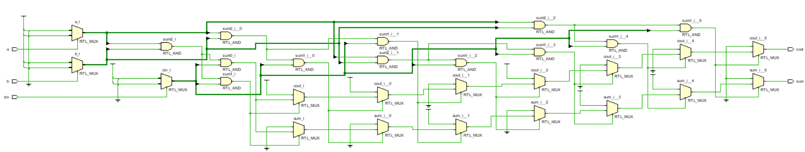

#### Figure 12: Full-adder `if-else` simulation
*Simulation waveform verifying that all `if-else` branches resolve cleanly without latch inference.*

#### Figure 13: 4-bit ripple-carry adder schematic
*Structural 4-bit ripple-carry adder (`rca_4bit.v`) showing four cascaded full-adder stages from LSB to MSB.*

#### Figure 14: 4-bit ripple-carry adder simulation
*Simulation waveform highlighting 4-bit addition and final `cout` overflow cases such as `15 + 1` and `15 + 15`.*

---

## 2. Multiplexers — `02_Multiplexers/`

A 2-to-1 multiplexer routes one of two inputs to its output: `y = (~s & i0) | (s & i1)`. When `s` is `0`, `y` follows `i0`; when `s` is `1`, `y` follows `i1`. `MUX_2x1.v`, `MUX_2x1_gate.v`, and `MUX2x1_data.v` show the same selection behavior expressed in behavioral, gate-level, and dataflow styles.

`mux_4x1.v` builds a 4-to-1 MUX structurally from three 2-to-1 instances: `s0` selects within each input pair, and `s1` chooses between the two intermediate outputs.

### Figures

#### Figure 15: Behavioral 2-to-1 MUX schematic
*Elaborated RTL schematic generated from the behavioral 2-to-1 multiplexer (`MUX_2x1.v`).*

#### Figure 16: Behavioral 2-to-1 MUX simulation
*Simulation waveform showing output `y` tracking `i0` when `s = 0` and switching to `i1` when `s = 1`.*

#### Figure 17: Gate-level 2-to-1 MUX schematic
*Gate-level schematic of `MUX_2x1_gate.v` showing the explicit `not`, `and`, and `or` sum-of-products network.*

#### Figure 18: Gate-level 2-to-1 MUX simulation
*Simulation waveform confirming that the gate-level 2-to-1 MUX matches the behavioral selector.*

#### Figure 19: Dataflow 2-to-1 MUX schematic
*Elaborated schematic of `MUX2x1_data.v` expressing the 2-to-1 selection equation in dataflow style.*

#### Figure 20: Dataflow 2-to-1 MUX simulation
*Simulation waveform verifying clean routing between `i0` and `i1` across all select transitions.*

#### Figure 21: 4-to-1 MUX hierarchical schematic
*Hierarchical schematic of `mux_4x1.v` built from three 2-to-1 MUX instances in a two-level tree.*

#### Figure 22: 4-to-1 MUX simulation
*Simulation waveform stepping `s[1:0]` from `00` to `11` to verify each of the four routed input channels.*

---

## 3. Demultiplexers and decoders — `03_Decoders_Demux/`

A 1-to-4 demultiplexer routes a single data input to one of four outputs based on two select bits. A 2-to-4 decoder performs a related function by asserting one active output corresponding to a 2-bit input code. These circuits are used heavily in address decoding, enable gating, and control logic.

`dec_3to8.v` expands this concept structurally by combining two enabled 2-to-4 decoders to produce eight one-hot outputs. `func_decoder.v` shows how decoder outputs (minterms) can be ORed together to form Boolean functions.

### Figures

#### Figure 23: 1-to-4 demultiplexer schematic
*Elaborated schematic showing select-line decoding gating a single input `d` onto four output channels.*

#### Figure 24: 1-to-4 demultiplexer simulation
*Simulation waveform routing `d` to the addressed output channel while the remaining three stay `0`.*

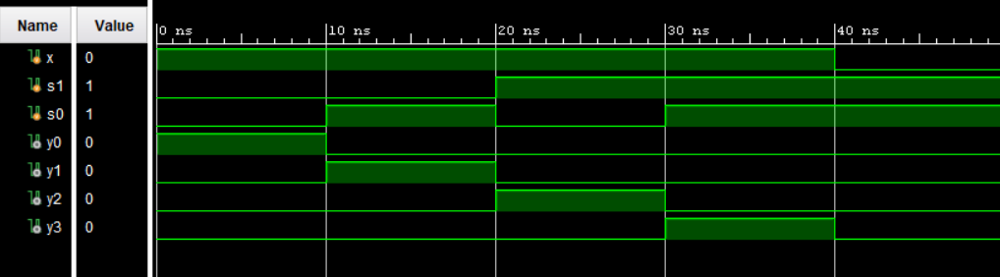

#### Figure 25: 2-to-4 decoder schematic
*Elaborated schematic of the 2-to-4 decoder mapping a 2-bit input code to four one-hot outputs.*

#### Figure 26: 2-to-4 decoder simulation
*Simulation waveform verifying one-hot output assertion for each 2-bit input code (`00` through `11`).*

#### Figure 27: 3-to-8 decoder structural schematic
*Structural schematic of `dec_3to8.v` combining two enabled 2-to-4 decoders to expand output width to eight lines.*

#### Figure 28: 3-to-8 decoder simulation
*Simulation waveform sweeping `000` to `111` and producing a clean one-hot staircase across all eight outputs.*

#### Figure 29: Decoder-based Boolean function schematic
*Elaborated schematic of `func_decoder.v` combining selected decoder minterm outputs with OR logic.*

#### Figure 30: Decoder-based Boolean function simulation
*Simulation waveform confirming that output `y` asserts high only on the selected minterms of the target function.*

---

## 4. Gray-to-binary conversion — `04_Code_Converters/`

In a reflected Gray-code sequence, adjacent values differ in only one bit. This property helps reduce the risk of sampling an intermediate glitch when multi-bit values cross physical signal boundaries.

For 4-bit Gray-to-binary conversion, the MSB passes through directly and each subsequent binary bit is the XOR of the preceding binary bit and the current Gray bit:

- `B[3] = G[3]`
- `B[2] = B[3] ^ G[2]`
- `B[1] = B[2] ^ G[1]`
- `B[0] = B[1] ^ G[0]`

`gtob_data.v` implements these XOR equations directly, whereas `gtob_case.v` maps all 16 input combinations explicitly with a `default` branch to keep the combinational `case` block complete.

### Figures

#### Figure 31: Gray-to-binary conversion schematic
*Elaborated schematic of `gtob_data.v` showing the three-stage XOR cascade from Gray MSB to binary LSB.*

#### Figure 32: Gray-to-binary conversion simulation
*Simulation waveform sweeping all 16 four-bit Gray-code inputs and verifying their decoded binary outputs.*

---

## 5. One-bit magnitude comparator — `05_Comparators/`

The 1-bit comparator produces three mutually exclusive outputs:

- `g = a & ~b`: `a` is greater than `b`.
- `e = a ~^ b`: `a` is equal to `b` (XNOR).
- `s = ~a & b`: `a` is smaller than `b`.

For multi-bit unsigned comparators, comparison proceeds from the MSB downward; the first differing bit position determines which operand is larger.

### Figures

#### Figure 33: 1-bit comparator schematic
*Elaborated schematic showing the parallel inverter, AND, and XNOR paths driving `g`, `e`, and `s`.*

#### Figure 34: 1-bit comparator simulation
*Simulation waveform testing all four input pairs (`00`, `01`, `10`, `11`) and confirming mutually exclusive comparison outputs.*

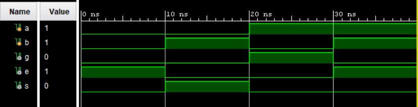

---

## 6. Sequential logic, registers, and counters — `06_Sequential_Logic_Basics/`

Unlike combinational circuits, sequential circuits include memory elements that retain past state, forming the basis of registers, counters, RAM, and ROM. Every sequential element relies on a clock or other timing event to decide when state should update.

### Triggering and storage elements

- **Level-sensitive latch vs. edge-triggered flip-flop:** A latch is transparent while its enable level is active and holds its value otherwise. A flip-flop samples inputs and updates state only at an active clock edge.
- **SR latch (`sr_latch.v`):** Built from cross-coupled NOR (or NAND) gates. For an active-high NOR latch, `S=1, R=0` sets `Q=1`, `S=0, R=1` resets `Q=0`, `S=R=0` holds `Q`, and `S=R=1` is invalid because it drives both outputs to `0`.
- **SR flip-flop (`sr_ff.v`):** Adds clock gating inside `always @(posedge clk)`. Any output assigned inside an `always` block must be declared as `output reg` (or `logic` in SystemVerilog).
- **D flip-flop (`d_ff.v`, `d_ff_clr.v`):** The simplest flip-flop, capturing `Q <= D` on the active clock edge. `d_ff_clr.v` adds a synchronous `clear` checked on the clock edge.
- **T flip-flop (`t_ff.v`):** Holds `Q` when `T=0` and toggles (`Q <= ~Q`) when `T=1`. Without an explicit reset or simulation initialization, `Q` may remain unknown (`X`) at start-up.
- **JK flip-flop (`jk_ff.v`):** Modifies the SR flip-flop so that `J=1, K=1` toggles `Q` instead of entering an invalid state, implemented cleanly with `case({J, K})`.

| Storage element | Triggering | Key behavior / special case |
| :--- | :--- | :--- |
| **SR latch** | Level-sensitive | `S=1, R=1` is invalid; holds when `S=R=0` |
| **SR flip-flop** | Edge-triggered | Clocked SR; requires `output reg`; `sr_ff.v` holds `q`/`qbar` on `S=R=1` |
| **D flip-flop** | Edge-triggered | `Q(t+1) = D`; core building block for registers |
| **T flip-flop** | Edge-triggered | Toggles when `T=1`; needs reset or init to avoid `X` |
| **JK flip-flop** | Edge-triggered | Eliminates invalid state; toggles when `J=1, K=1` |

### Registers and shift registers

A register groups multiple flip-flops under a shared clock to store multi-bit words (`reg [3:0] Q`).

- **Load and clear priority (`reg_4bit.v`, `reg_4bit_str.v`, `reg_4bit_clear.v`):** `reg_4bit_str.v` pairs each D flip-flop with a 2-to-1 MUX so `load=0` feeds back `Q` (hold) and `load=1` loads `D`.
- **I/O modes:** Registers are categorized by how data enters and exits: SISO, SIPO, PISO, and PIPO.
- **4-bit SIPO shift register (`sipo_4bit.v`):** Shifts 1 bit of serial input (`Din`) per active clock edge; a full 4-bit parallel word (`Q[3:0]`) is available after four clock cycles.
- **4-bit bidirectional PIPO shift register (`reg_pipo.v`):** Uses a 4-to-1 MUX to select among hold, left shift, right shift, and parallel load.

| `CTRL[1:0]` | Operation | Next-state source |
| :--- | :--- | :--- |
| `00` | Hold | Current `Q` |
| `01` | Left shift | Serial input `XL` and neighbor bits |
| `10` | Right shift | Serial input `XR` and neighbor bits |
| `11` | Parallel load | Parallel input `D[3:0]` |

### Counters and patterns

- **Asynchronous (ripple) counter (`counter_4_async.v`):** Each flip-flop’s output clocks the next stage. While simple to wire, accumulated propagation delay makes ripple counters slower and less timing-friendly than synchronous counters.
- **Synchronous counter:** All flip-flops share a single clock edge, providing uniform timing and fewer glitches at the cost of more complex next-state logic.
- **Pattern counters (ring and Johnson):**
  - A 4-bit ring counter circulates a single `1` bit through four states (`1000 -> 0100 -> 0010 -> 0001`). This concept is documented here; no separate ring-counter file exists in this folder.
  - A 4-bit Johnson counter (`count_4_johnson.v`) feeds the inverted last bit back into the shift chain, cycling through eight states.

### Figures

#### Figure 35: SR latch RTL schematic
*Elaborated schematic of `sr_latch.v` showing the cross-coupled `RTL_OR` and `RTL_INV` feedback loop.*

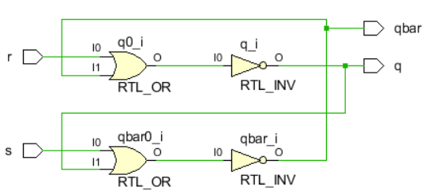

#### Figure 36: SR latch simulation waveform
*Simulation waveform demonstrating asynchronous set, reset, and hold behavior following an initial `X` state.*

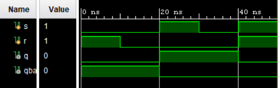

#### Figure 37: SR flip-flop RTL schematic
*Elaborated schematic of `sr_ff.v` showing `RTL_REG_SYNC` storage elements gated by `S` and `R` combinational logic.*

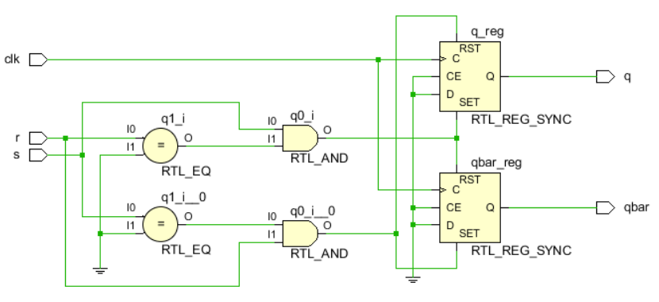

#### Figure 38: SR flip-flop simulation waveform
*Simulation waveform confirming clocked set, reset, and hold updates at `posedge clk`.*

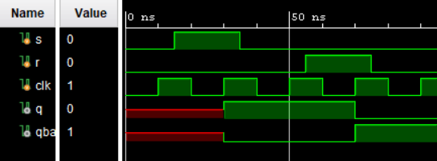

#### Figure 39: D flip-flop RTL schematic
*Elaborated schematic of `d_ff.v` mapping `Q <= D` into a single `RTL_REG` storage element.*

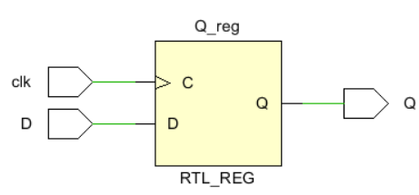

#### Figure 40: D flip-flop simulation waveform
*Simulation waveform confirming `Q` samples `D` at each rising clock edge and holds between edges.*

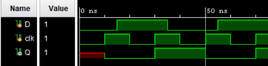

#### Figure 41: T flip-flop RTL schematic
*Elaborated schematic of `t_ff.v` showing `RTL_INV` feedback and `T` driving the register clock-enable (`CE`).*

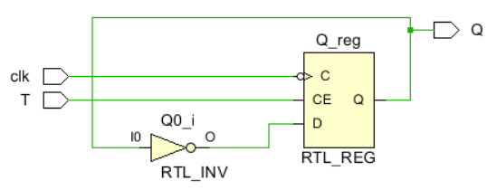

#### Figure 42: T flip-flop simulation waveform
*Simulation waveform verifying state hold when `T = 0` and toggling when `T = 1` from an initialized `Q = 0`.*

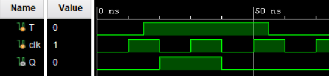

#### Figure 43: JK flip-flop RTL schematic
*Elaborated schematic of `jk_ff.v` showing `RTL_MUX` next-state selection feeding an `RTL_REG`.*

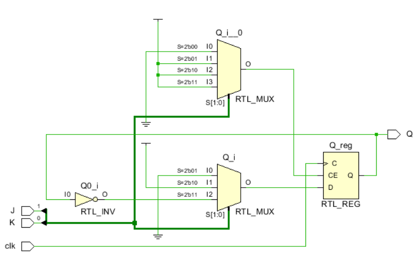

#### Figure 44: JK flip-flop simulation waveform
*Simulation waveform verifying hold (`00`), reset (`01`), set (`10`), and toggle (`11`) behavior at clock edges.*

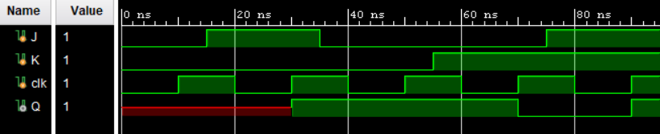

#### Figure 45: 4-bit register RTL schematic
*Elaborated schematic of `reg_4bit.v` capturing a 4-bit bus `D[3:0]` onto `Q[3:0]` on `clk`.*

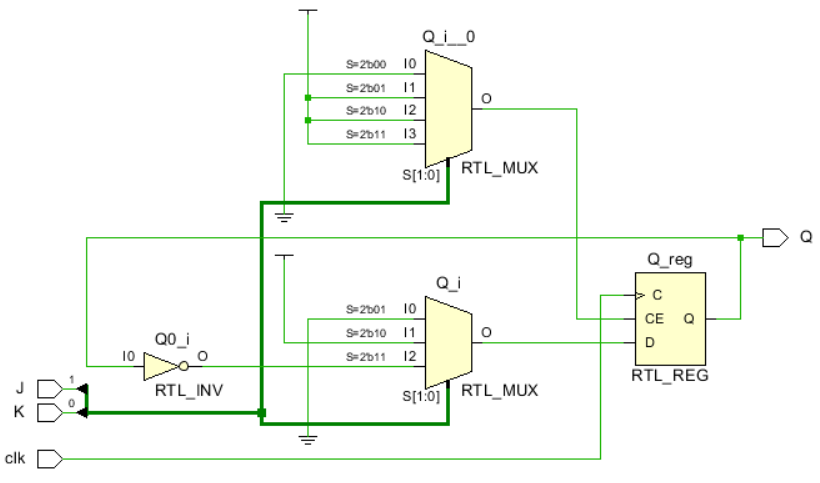

#### Figure 46: 4-bit register simulation waveform
*Simulation waveform showing parallel 4-bit updates from `D[3:0]` to `Q[3:0]` at each active clock edge.*

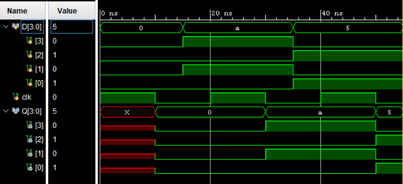

#### Figure 47: Structural 4-bit loadable register RTL schematic
*Structural schematic of `reg_4bit_str.v` pairing four `MUX_2x1_gate` instances with four `DFF` instances.*

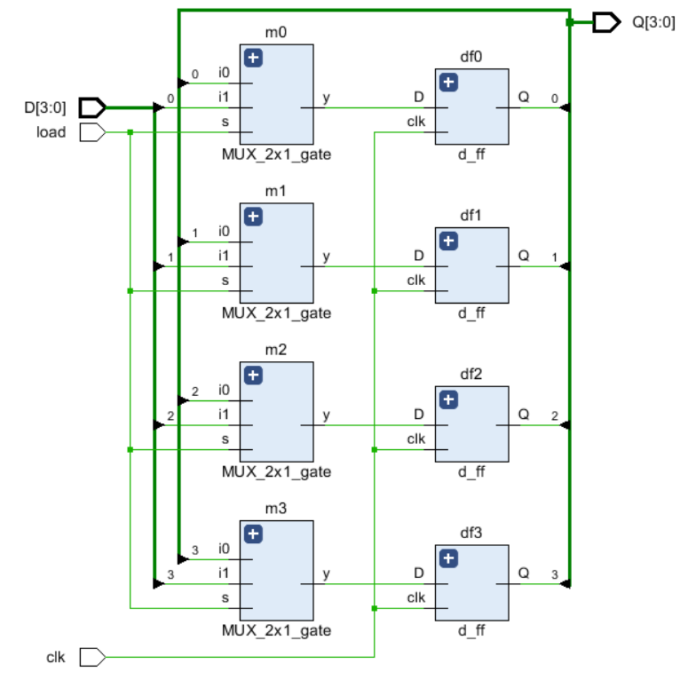

#### Figure 48: Structural 4-bit loadable register simulation waveform
*Simulation waveform verifying state hold when `load = 0` and parallel data capture when `load = 1`.*

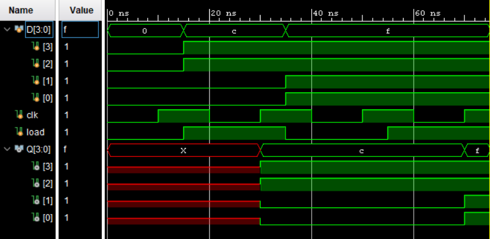

#### Figure 49: 4-bit register with synchronous clear RTL schematic
*Elaborated schematic of `reg_4bit_clear.v` showing `clear` priority ahead of `load` and hold feedback.*

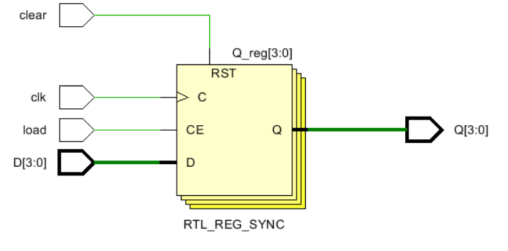

#### Figure 50: 4-bit register with synchronous clear simulation waveform
*Simulation waveform confirming `clear = 1` resets `Q[3:0]` to `0` on `posedge clk` regardless of `load`.*

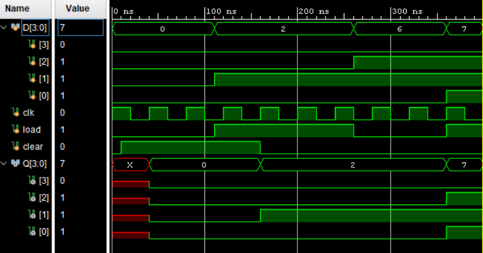

#### Figure 51: D flip-flop with synchronous clear RTL schematic
*Elaborated schematic of `d_ff_clr.v`, the single-bit building block with synchronous clear used in `reg_pipo.v`.*

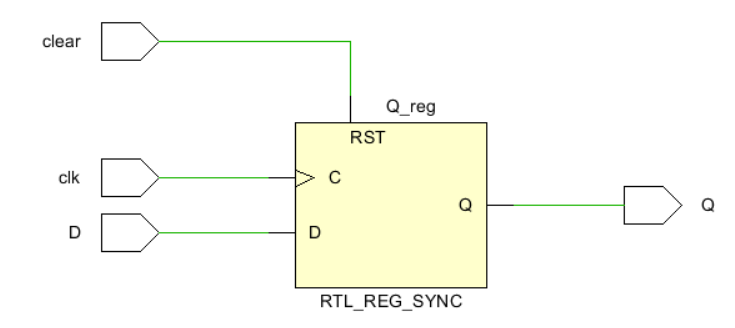

#### Figure 52: 4-to-1 MUX building block for PIPO shift register RTL schematic
*Elaborated schematic of `mux_4x1_pipo` selecting among hold (`00`), left shift (`01`), right shift (`10`), and parallel load (`11`).*

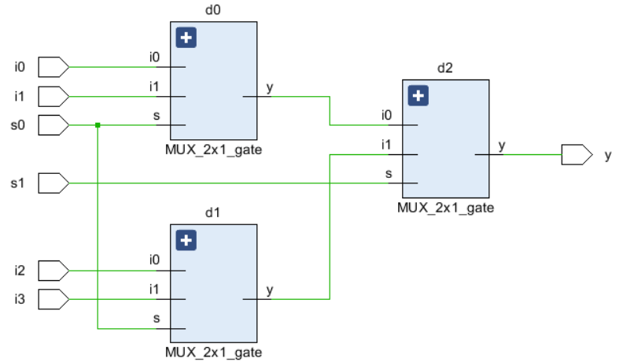

#### Figure 53: 4-bit bidirectional PIPO shift register RTL schematic
*Structural schematic of `reg_pipo.v` wiring four `mux_4x1_pipo` instances into four `d_ff_clr` flip-flops.*

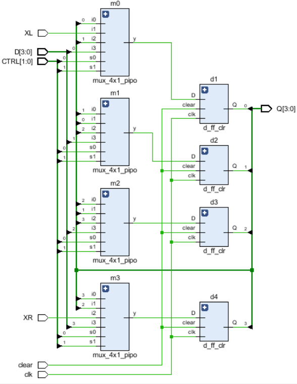

#### Figure 54: 4-bit bidirectional PIPO shift register simulation waveform
*Simulation waveform exercising parallel load (`11`), left shift (`01`), right shift (`10`), and hold (`00`).*

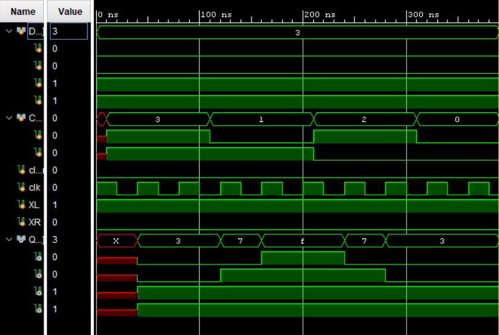

#### Figure 55: 4-bit SIPO shift register RTL schematic
*Elaborated schematic of `sipo_4bit.v` chaining four flip-flops serially with parallel taps `Q[3:0]`.*

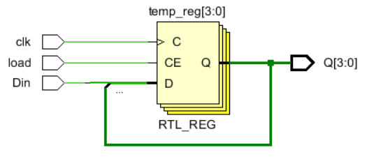

#### Figure 56: 4-bit SIPO shift register simulation waveform
*Simulation waveform showing `Din` shifting across four clock edges (`XXX1 -> XX11 -> X111 -> 1111`) until `Q[3:0]` is full.*

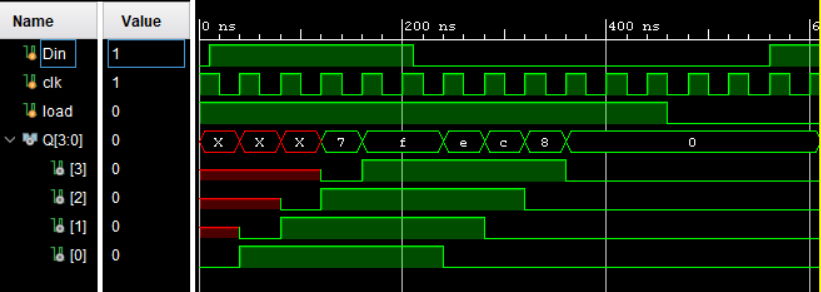

#### Figure 57: 4-bit asynchronous (ripple) counter RTL schematic
*Elaborated schematic of `counter_4_async.v` where each stage’s output ripples into the next stage’s clock.*

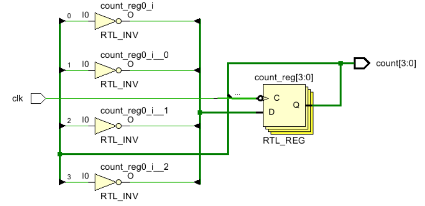

#### Figure 58: 4-bit asynchronous (ripple) counter simulation waveform
*Simulation waveform of `counter_4_async.v` counting upward (`0` to `15`) using falling-edge ripple triggers across all four stages.*

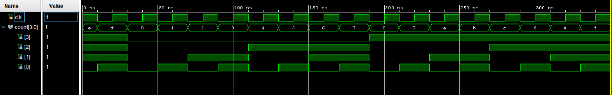

#### Figure 59: 4-bit Johnson counter RTL schematic
*Elaborated schematic of `count_4_johnson.v` with inverted LSB feedback (`~temp[0]`) and asynchronous `reset`.*

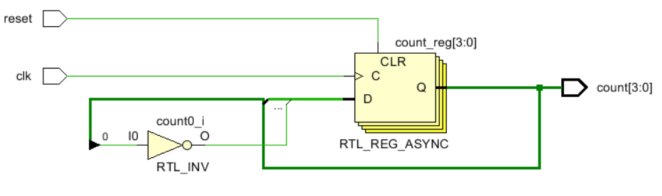

#### Figure 60: 4-bit Johnson counter simulation waveform
*Simulation waveform cycling through the eight-state twisted-ring sequence (`0 -> 8 -> c -> e -> f -> 7 -> 3 -> 1 -> 0`).*

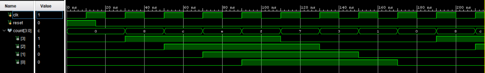

---

## 7. Verilog debugging and synthesizable RTL — `07_Verilog_Debugging/`

Effective debugging starts with reproducing the issue and identifying its stage: syntax error, compilation/elaboration error, runtime/simulation mismatch, or synthesis warning.

### Effective debugging practices

- **Isolate the context:** Record the exact error message, tool and version (Vivado or ModelSim), affected module and port names, vector widths, and clock/reset conditions.
- **Trace `X` values:** Unknown states in waveforms often indicate uninitialized registers, missing reset assertions, multi-driver conflicts, or incomplete testbench stimulus.
- **Write actionable problem reports:** Provide the exact diagnostic text, tool name, and the minimal module plus testbench code rather than vague descriptions like “my code is not working.”

### Synthesizable RTL guidelines

Synthesizable RTL describes logic that synthesis tools such as Vivado or Quartus can map onto physical gates, multiplexers, and flip-flops:

- Use nonblocking assignments (`<=`) for sequential state updates and blocking assignments (`=`) for combinational calculations.
- Assign all outputs on every path in combinational `always @*` blocks to avoid unintended latch inference.
- Keep sensitivity lists complete (`always @*` in Verilog or `always_comb` in SystemVerilog).
- Describe reset behavior explicitly and consistently (synchronous or asynchronous, active-high or active-low).
- Keep simulation-only constructs—such as `#` delays, `forever` loops, `wait` statements, file I/O, and `real` data types—out of RTL modules and inside testbenches.
- Avoid `initial` blocks in portable ASIC RTL; FPGA tools may support them for certain resources, depending on device and flow.
- Inspect synthesis warnings as well as errors; warnings frequently reveal inferred latches, undriven nets, width mismatches, or trimmed logic.

### Synthesizability checklist

1. Remove `#` delays and simulation-only tasks from synthesizable RTL files.
2. Confirm combinational blocks assign every output on all paths and sequential blocks trigger on the intended clock edge.
3. Verify reset polarity, synchronous/asynchronous behavior, and priority relative to control signals like `load`.
4. Check port directions and vector widths across module instantiations.
5. Run synthesis in Vivado or Quartus and review warnings alongside errors.

Note: `07_Verilog_Debugging/` currently contains documentation rather than standalone design or testbench files.

---

## 8. Finite state machines — `08_Finite_State_Machines/`

A Finite State Machine (FSM) describes the sequence of steps taken by a digital system. The system transitions between a finite number of conditions (states) based on incoming inputs and internal timing.

FSMs are usually categorized as:

- **Moore machine:** The output depends strictly on the current state.
- **Mealy machine:** The output depends on both the current state and the current input values.

To ensure synthesizability and avoid simulation hazards, all FSMs in this repository are modeled using a standard three-block architecture:

1. **State register:** A sequential `always @(posedge clk)` block that updates `state <= next_state`.
2. **Next-state logic:** A combinational `always @*` block using a complete `case` statement to determine transitions.
3. **Output logic:** A combinational `always @*` block driving outputs based on `state` (Moore) or `state` and inputs (Mealy).

### FSM counters

- **Enabled counter (`fsm_counter.v`):** Cycles through states `S0` to `S3` only when the `din` (enable) signal is asserted.
- **Up/down counter (`fsm_up_down_count.v`):** A 4-state machine where `dir = 0` triggers upward counting and `dir = 1` triggers downward counting.

### Pattern detectors

A pattern detector monitors a running serial bitstream to recognize a specific sequence such as `1011`.

- **Moore implementation (`fsm_pattern_moore.v`):** Requires 5 distinct states (`Sin`, `S1`, `S10`, `S101`, `S1011`) to detect the 4-bit `1011` sequence because the output must be mapped to a dedicated state.
- **Mealy implementation (`fsm_pattern_mealy.v`):** Requires only 4 states (`Sin`, `S1`, `S10`, `S101`). The output is asserted dynamically during the transition from the final state while the input matches the expected next bit.

### Figures

#### Figure 61: FSM counter RTL schematic
*Elaborated schematic of `fsm_counter.v` showing the state register and combinational next-state routing.*

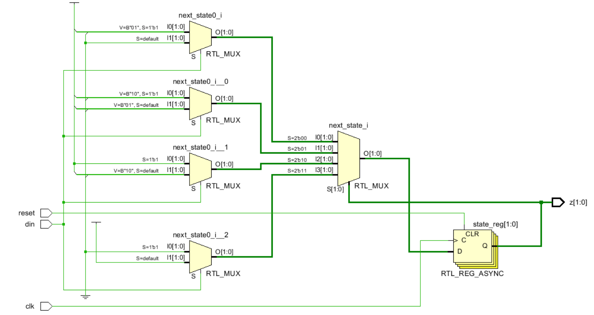

#### Figure 62: FSM counter simulation waveform
*Simulation waveform showing state transitions pausing when `din = 0` and resuming when `din = 1`.*

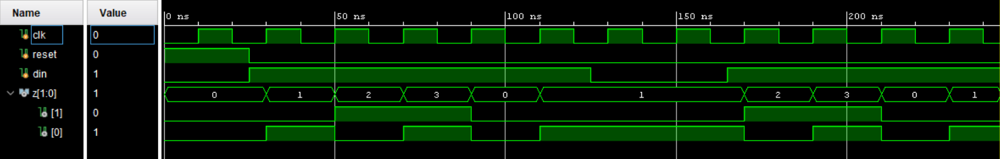

#### Figure 63: Up/down counter FSM RTL schematic
*Elaborated schematic of `fsm_up_down_count.v` driven by the `dir` control signal.*

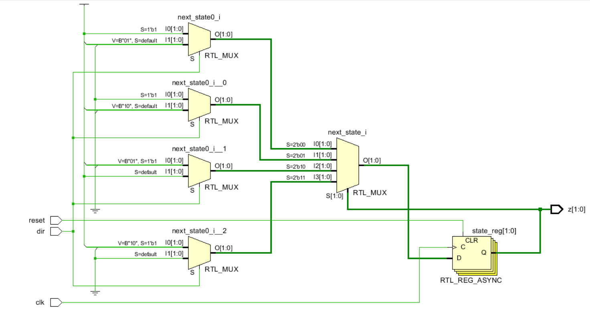

#### Figure 64: Up/down counter FSM simulation waveform
*Simulation waveform verifying directional changes when `dir` toggles between `0` and `1`.*

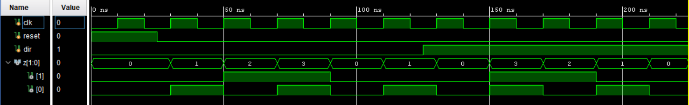

#### Figure 65: Moore pattern detector RTL schematic
*Elaborated schematic of `fsm_pattern_moore.v` demonstrating the 5-state logic architecture.*

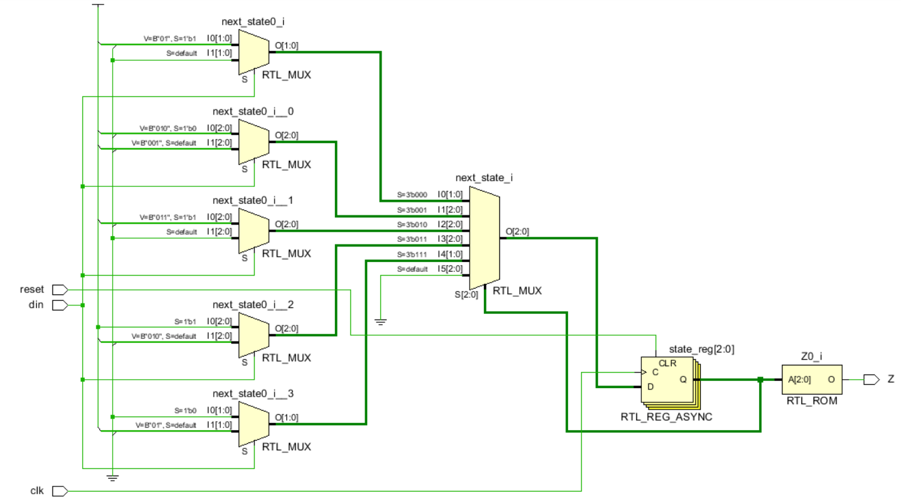

#### Figure 66: Moore pattern detector simulation waveform
*Simulation waveform showing `Z` asserting high exclusively when the state reaches `S1011`.*

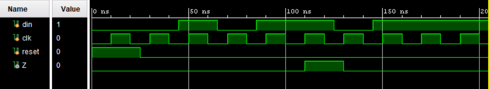

#### Figure 67: Mealy pattern detector RTL schematic
*Elaborated schematic of `fsm_pattern_mealy.v` demonstrating the reduced 4-state logic architecture.*

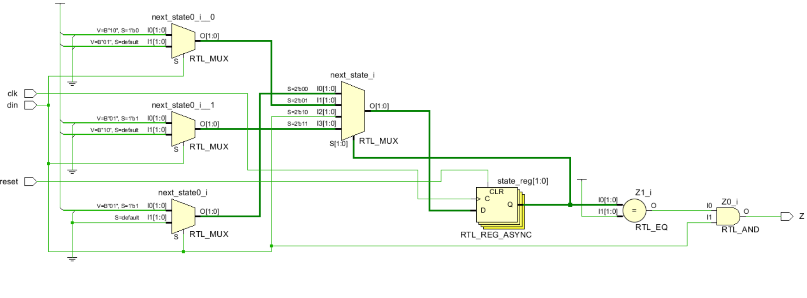

#### Figure 68: Mealy pattern detector simulation waveform
*Simulation waveform showing `Z` asserting immediately based on current input and state combination.*

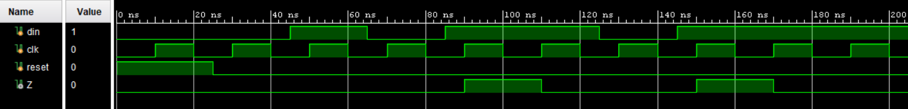

---

## 9. FPGA architecture and implementation flow — `09_FPGA_Implementation_Basics/`

Field Programmable Gate Arrays (FPGAs) are reconfigurable semiconductor devices that let one hardware board act like different digital circuits over time. For example, a half adder, a counter, or a custom state machine can all be implemented on the same FPGA by loading different configuration data.

### FPGA architecture

- **Configurable Logic Block (CLB):** The core logic tile inside the FPGA. Each CLB contains 6-input look-up tables (LUTs), small memory-based truth tables that realize combinational functions, along with flip-flops and routing resources.
- **Programmable interconnects:** The routing matrix that wires CLBs and I/O blocks together across the chip.
- **I/O blocks:** Interface internal FPGA routing to physical pins on the board, including switches, LEDs, 7-segment displays, and Pmod headers.

### Constraints file generation

Every physical component on the Basys 3 board has a fixed package pin code and voltage standard (`IOSTANDARD LVCMOS33` for 3.3 V CMOS logic):

- **Start from the master template:** Download the official board template (`Basys3_Master.xdc`), where all pins are commented out with `#`.
- **Map only active ports:** Uncomment the lines for the components your design uses, replace the placeholder port names inside `get_ports {...}` with your actual Verilog port names, and leave all unused lines commented out.
- **One active `.xdc` rule:** A Vivado project can store multiple `.xdc` files, but only one constraints file should be active for synthesis and implementation.
- **Target device selection:** Before running synthesis, set the Vivado project part to match the Basys 3 Artix-7 device: `xc7a35tcpg236-1`.

### Vivado hardware implementation flow

1. **Pre-check (simulation first):** Verify RTL syntax and functional waveforms in behavioral simulation before moving to hardware steps.
2. **Synthesis:** Translates Verilog RTL into logic gates and maps them onto the target FPGA’s CLBs and LUTs using the active `.xdc`. Produces a post-synthesis schematic and resource estimates.
3. **Implementation:** Places logic onto physical CLB sites and routes programmable interconnects using the same active `.xdc` and board. Produces the device/package pin-mapping view, timing summary, and utilization report.
4. **Bitstream generation:** Compiles the routed design into `<ModuleName>.bit`, encoding all pin, LUT, and display configurations.
5. **Hardware manager and testing:** Connect the Basys 3 over USB, open Hardware Manager, and program the `.bit` file onto the device. This is the stage where the design is proven on real hardware.

### 7-segment display interfacing

A 7-segment display contains seven LEDs (`a`–`g`) plus a decimal point (`DP`) wired across 10 pins, with pins 3 and 8 tied together as the common terminal.

- **Common-anode (Basys 3):** Because the Basys 3 uses a common-anode display, both the segment lines (`seg[6:0]`) and the 4-digit anode enables (`an[3:0]`) are active-low. `0` turns a segment or digit ON; `1` turns it OFF.
- **Digit selection and decoding:** `RCA_4_bit_7seg.v` sets `an = 4'b1110` to activate only the rightmost digit, computes the 4-bit sum `S[3:0]` and `Cout` across four `FA_data` stages, and uses a `case` block to map the count value onto the active-low pattern for `seg[6:0]`.

---

## 10. RTL mini-projects — `10_RTL_Mini_Projects/`

This section applies combinational datapaths, 7-segment display encoding, and multi-state FSM design to three self-contained hardware systems. It also extends the Vivado workflow from basic behavioral simulation into hardware-targeted constraints and post-synthesis checks.

### 10.1 Car parking management system (`Car_parking.v`, `Car_parking_7_seg.v`)

Each parking slot is represented by a 1-bit sensor input (`Cars[7:0]`), where logic `1` indicates an occupied space. A combinational `always @*` block sums all eight sensor bits into a 4-bit count (`num`), allowing simulation waveforms to display the occupied count directly as an unsigned decimal value.

For FPGA deployment on the Nexys 4 DDR (`Car_parking_Nexys.xdc`), `Car_parking_7_seg.v` maps `Cars[7:0]` to physical switches (`SW[7:0]`) and drives the rightmost common-anode 7-segment digit. A `case(num)` lookup converts counts `0` through `8` into active-low segment patterns (`seg[6:0]`), with a `default` assignment to prevent unintended latch inference.

### 10.2 Vending machine controller (`Vending_machine.v`)

The vending machine is structured as a 9-state FSM (`Sin` through `S80`) tracking cumulative inserted value toward a 40-unit product price. On each `posedge clk`, the machine samples a 2-bit `coin` input (`ten = 2'b00`, `twenty = 2'b01`, `fifty = 2'b10`) and advances to the corresponding sum state, while an active-high `reset` returns it to `Sin`.

- **Dispense and change logic:** States `Sin`–`S30` keep `Z = 0` and `change_given = 0`. Reaching `S40` asserts `Z = 1` with no change (`change_given = 0`), while `S50`–`S80` assert both `Z = 1` and `change_given = 1` before returning unconditionally to `Sin` on the next clock cycle.
- **Stimulus timing:** Inputs must be updated before the rising clock edge so the same currency note is not sampled twice across consecutive cycles.

### 10.3 4-way traffic light controller (`Traffic_sys.v`)

The intersection controller uses an 8-state FSM rotating through `north`, `west`, `south`, and `east`, with dedicated yellow transition states between each green phase. Each direction uses a 3-bit output (`2'b001` = Green, `2'b010` = Yellow, `2'b100` = Red) so only one road moves at a time.

- **Scaled timing counter:** A 4-bit register `count` holds each green state for 16 clock cycles (`4'b1111`) and each yellow state for 4 clock cycles (`4'b0011`), scaling a 30 s / 5 s real-world timing ratio down for practical waveform inspection.
- **Emergency reset:** Asserting `reset` immediately forces `state` back to `north` and clears `count` to zero.

### 10.4 Verification and implementation notes

Following Xilinx Vivado simulation and power-analysis practices, these projects are verified by running behavioral simulation across full state rotations and randomized sensor inputs before moving to synthesis and implementation. When targeting hardware, keeping a single active `.xdc` file per project and reviewing post-implementation utilization and timing reports ensures clean pin mapping and predictable switching behavior.

### Figures

*(Drop your Vivado screenshots into `10_RTL_Mini_Projects/images/` with matching filenames once simulated/implemented.)*

#### Figure XX: Car parking system behavioral simulation
*Simulation waveform showing `Cars[7:0]` sensor combinations and the corresponding `num[3:0]` count.*

#### Figure XX+1: Car parking 7-segment RTL schematic
*Elaborated schematic of `Car_parking_7_seg` driving `seg[6:0]` and `AN[7:0]` for Nexys 4 DDR.*

#### Figure XX+2: Vending machine FSM simulation
*Waveform verifying `Sin`–`S80` state transitions, product dispense (`Z`), and change return (`change_given`).*

#### Figure XX+3: 4-way traffic controller simulation
*Waveform showing full 4-direction green/yellow/red rotation and `reset` recovery.*

## Scope and next work

This repository covers combinational arithmetic, multiplexing, decoding, code conversion, and comparison alongside sequential storage elements, shift registers, counters, finite-state machines, Basys 3 FPGA implementation, and applied RTL mini-projects. Future additions can expand into parameterized/reusable modules, automated self-checking testbenches, and post-implementation timing and power analysis in Vivado.

This repository now spans combinational arithmetic, multiplexing, decoding, code conversion, and comparison alongside sequential storage elements, shift registers, counters, and synthesizable RTL practice. It also includes finite-state control design, where a system’s behavior is modeled as a set of state transitions instead of a purely arithmetic function. The next logical extension is to add more complex FSMs, protocol controllers, and datapath-driven designs that combine control sequencing with arithmetic blocks.

---

