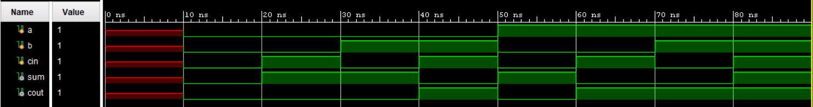
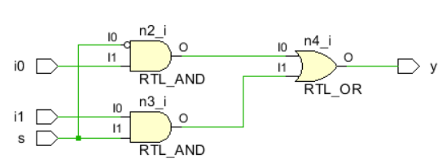
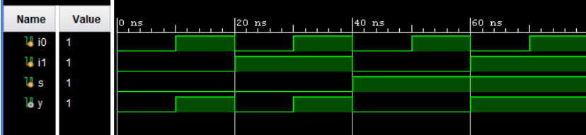
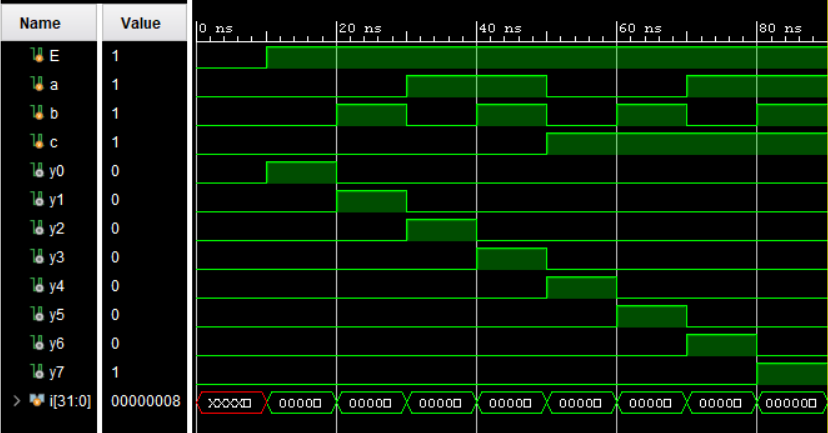
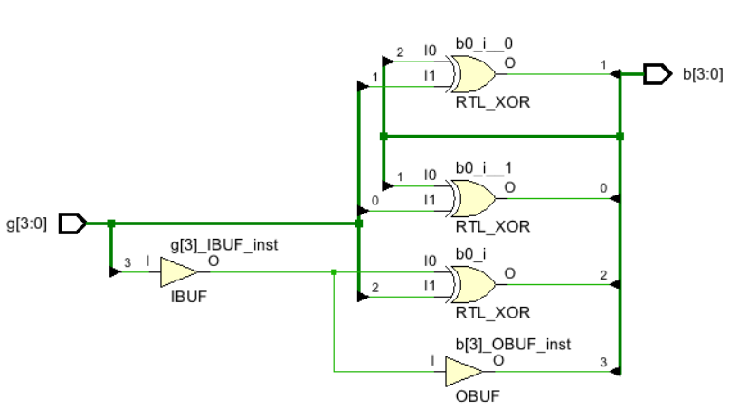

# Verilog RTL Learning Log

This log connects the circuits in this repository to the RTL concepts they demonstrate. The examples are small combinational designs: their outputs depend on the current inputs, with no clocked state.

## VLSI, FPGA, and RTL

VLSI design covers the path from defining a circuit's behavior to implementing and checking it. In this repository, the focus is on RTL and basic simulation. An FPGA implements logic using configurable resources, while the RTL description defines the intended logic behavior before synthesis.

Verilog describes hardware behavior, not a sequence of software instructions:

- A `wire` is a net driven by a continuous assignment, a module output, or a primitive. A Verilog `reg` is a procedural variable; it does not by itself imply a hardware register. For example, `output` ports are often nets, while variables assigned inside `always` blocks are procedural state.
- `assign` continuously drives a net. Procedural assignments (`=` or `<=`) are used inside `always` or `initial` blocks.
- Blocking assignment (`=`) takes effect immediately in procedural order. Nonblocking assignment (`<=`) schedules an update for the end of the current simulation time step and is the usual choice for synchronous hardware descriptions.
- Simulation uses `0`, `1`, `X` (unknown or conflicting), and `Z` (high impedance). Unknown values can expose uninitialized inputs or incomplete stimulus. `Z` is mainly useful for modeling tri-state behavior.
- Bitwise operators (`&`, `|`, `^`) operate bit by bit; logical operators (`&&`, `||`) produce a Boolean result. Case equality (`===`, `!==`) compares `X` and `Z` explicitly, which can be useful in testbenches and debugging.
- Structural RTL connects instances of smaller modules. Named port connections, used in designs such as `rca_4bit.v` and `mux_4x1.v`, make those connections easier to inspect.

### Combinational logic and checking

Every output in a combinational process must be assigned on every path. If an `if` or `case` omits an assignment, the output must retain its old value and a latch may be inferred. `MUX_2x1.v` assigns a result in all branches, so it remains purely combinational.

The `tb_*.v` files apply input patterns and use `$monitor` to print signal changes. A printed truth table is useful for visual inspection, but it does not automatically check correctness. A self-checking testbench compares expected results to actual ones, which makes simulation verification more reliable.

The project READMEs describe a Vivado workflow: add the design and its testbench as simulation sources, set the testbench as the simulation top, and run behavioral simulation. The repository does not use advanced synthesis or timing analysis; it focuses on logic understanding and simulation-driven validation.

## 1. Adders — `01_Adders_basics/`

A half adder adds two one-bit inputs: `sum = a ^ b` and `carry = a & b`. A full adder adds a third input, `cin`; the sum is the XOR of all three inputs, and the carry is high when at least two inputs are high.

`rca_4bit.v` chains four full adders. Each bit's carry-out feeds the next bit's carry-in, from the least significant bit toward the most significant bit. This simple structure makes the dependency between stages clear and demonstrates carry propagation.

### Figures

The first four figures document the full-adder setup and its behavior: the force-clock view shows how inputs were driven in Vivado, the truth table lists all eight input combinations, and the schematic and waveform connect the logic to RTL simulation.

#### Figure 1: Vivado force-clock setup for the full adder
This setup drives the adder inputs under controlled timing so the logic can be exercised one bit pattern at a time.

#### Figure 2: Full-adder truth table
This table shows the eight possible input combinations and the resulting sum and carry values for the 1-bit adder.

#### Figure 3: Full-adder RTL schematic
The schematic shows the logical structure of the adder as implemented in RTL, highlighting the XOR and AND relationships behind the logic.

#### Figure 4: Full-adder simulation waveform
This waveform confirms that the adder output changes as expected for each input combination and that the carry-out is generated correctly.

The half-adder `case` pair and the full-adder `case`, gate, and `if` pairs compare different RTL descriptions of the same small combinational functions. For each pair, the schematic is the tool's logic view, and the waveform verifies the output behavior.

#### Figure 5: Half-adder case implementation schematic
This schematic shows the half adder written with a `case` statement, illustrating a behavioral description that still maps cleanly to basic logic.

#### Figure 6: Half-adder case simulation
The waveform verifies the half adder's sum and carry for all relevant input cases.

#### Figure 7: Full-adder case implementation schematic
This schematic shows the full adder described with a `case` statement, emphasizing a compact behavioral encoding of the truth table.

#### Figure 8: Full-adder case simulation
The waveform checks the full adder against all combinations of inputs and carry-in values.

#### Figure 9: Gate-level full-adder schematic
This view makes the primitive logic implementation visible: XOR and AND gates are explicitly connected to realize the adder function.

#### Figure 10: Gate-level full-adder simulation
The waveform confirms that the gate-level version behaves identically to the behavioral description of the same function.

#### Figure 11: Full-adder `if-else` implementation schematic
This implementation uses a procedural `if-else` structure to express the carry behavior in a natural RTL style.

#### Figure 12: Full-adder `if-else` simulation
This simulation verifies that the conditional logic produces the same outputs as the truth table and gate-level implementations.

The final pair shows the four-stage ripple connection and selected arithmetic cases. In particular, inputs such as 15 + 1 and 15 + 15 demonstrate why the 4-bit `sum` alone is not the full result: the carry-out matters for correct arithmetic width handling.

#### Figure 13: 4-bit ripple-carry adder schematic
This schematic shows the cascaded full adder stages, where each carry-out feeds the next stage.

#### Figure 14: 4-bit ripple-carry adder simulation
This waveform highlights edge cases such as overflow and final carry propagation in a 4-bit addition.

## 2. Multiplexers — `02_Multiplexers/`

A 2-to-1 multiplexer routes one of two inputs to its output: `y = (~s & i0) | (s & i1)`. When `s` is 0, the output follows `i0`; when `s` is 1, it follows `i1`. `MUX_2x1.v`, `MUX_2x1_gate.v`, and `MUX_2x1_data.v` each describe the same selection function in a different style.

`mux_4x1.v` builds a 4-to-1 MUX from three 2-to-1 instances. `s0` selects within each input pair, and `s1` selects between the two intermediate results. The testbench uses distinct input values so that each select code can be interpreted visually.

### Figures

The first two images show the behavioral 2-to-1 MUX: its schematic and the simulation response as the select input changes.

#### Figure 15: Behavioral 2-to-1 MUX schematic
This is the high-level RTL view of the selector, where the output is described by the selected input choice.

#### Figure 16: Behavioral 2-to-1 MUX simulation
The waveform shows how the output follows `i0` or `i1` depending on the select signal.

These images show the gate-level version. The gate schematic makes the inverter, AND, and OR implementation of the selection equation visible; the waveform checks its output against the selected data inputs.

#### Figure 17: Gate-level 2-to-1 MUX schematic
This schematic reveals the logic gates used to implement the mux equation directly in hardware.

#### Figure 18: Gate-level 2-to-1 MUX simulation
The waveform confirms that the gate-level implementation matches the intended selection behavior.

The dataflow version expresses the same selection equation with a continuous assignment. Its schematic and simulation are a comparison with the behavioral and gate-level descriptions, not a different function.

#### Figure 19: Dataflow 2-to-1 MUX schematic
This representation uses a continuous assignment to model the same logic equation in a compact, hardware-oriented style.

#### Figure 20: Dataflow 2-to-1 MUX simulation
The waveform shows that the continuous-assignment form behaves like the behavioral and gate-level versions.

The 4-to-1 MUX figures show the three-instance hierarchy and the output as all four select codes are applied.

#### Figure 21: 4-to-1 MUX hierarchical schematic
This schematic demonstrates how a larger mux can be built from smaller 2-to-1 mux blocks.

#### Figure 22: 4-to-1 MUX simulation
This waveform demonstrates the output for all four select values, making the selection tree easy to inspect.

## 3. Demultiplexers and decoders — `03_Decoders_Demux/`

A 1-to-4 demultiplexer routes one data input to one of four outputs, according to its two select bits. A 2-to-4 decoder does a related but different job: it activates one output corresponding to a two-bit input code.

`dec_3to8.v` composes enabled 2-to-4 decoders to produce eight one-hot outputs. `func_decoder.v` then demonstrates a common use for a decoder: OR selected minterm outputs to implement a Boolean function.

### Figures

The demultiplexer schematic shows the data-routing logic. Its simulation exercises the select combinations and shows which output receives the input value.

#### Figure 23: 1-to-4 demultiplexer schematic
This diagram highlights how the select bits choose which output channel receives the input data.

#### Figure 24: 1-to-4 demultiplexer simulation
The waveform shows the selected output receiving the input value while the others remain inactive.

The 2-to-4 decoder pair shows the one-hot output behavior for the two-bit input code. The separate 3-to-8 pair shows how the smaller enabled decoders are connected to expand the number of decoded outputs.

#### Figure 25: 2-to-4 decoder schematic
This schematic shows the one-hot decoding logic for a two-bit input value.

#### Figure 26: 2-to-4 decoder simulation
The waveform confirms that exactly one output is active for each valid input code.

#### Figure 27: 3-to-8 decoder structural schematic
This schematic demonstrates how enabled 2-to-4 decoders are combined to create a larger decoder.

#### Figure 28: 3-to-8 decoder simulation
The waveform verifies the eight one-hot outputs for all 3-bit input values.

The final pair documents the decoder-based function. The schematic shows the selected decoder outputs combined at `y`; the simulation applies input codes so the output can be compared with the chosen Boolean function.

#### Figure 29: Decoder-based Boolean function schematic
This view shows how decoder outputs are combined with OR logic to create a custom logic function.

#### Figure 30: Decoder-based Boolean function simulation
The waveform checks that the output matches the expected Boolean function for each input code.

## 4. Gray-to-binary conversion — `04_Code_Converters/`

In a reflected Gray-code sequence, adjacent values differ in one bit. This property can reduce the chance of observing a multi-bit transition partway through when a changing value crosses physical signal boundaries.

For four-bit Gray-to-binary conversion, the most significant binary bit is the Gray MSB, and each following binary bit is the XOR of the preceding binary bit and the next Gray bit:

- `B[3] = G[3]`
- `B[2] = B[3] ^ G[2]`
- `B[1] = B[2] ^ G[1]`
- `B[0] = B[1] ^ G[0]`

`gtob_data.v` expresses these equations directly. `gtob_case.v` lists all 16 input/output mappings. Its `default` assignment makes the combinational block complete; it is not a special mechanism needed for all combinational logic, but it ensures no unassigned case is left undefined.

The schematic shows the XOR logic inferred from the dataflow equations. The waveform corresponds to the testbench sweep over all 16 four-bit input patterns; the current testbench instantiates `gtob_data.v` and checks the conversion across the Gray sequence.

#### Figure 31: Gray-to-binary conversion schematic
This schematic makes the cascade of XOR operations visible, which is the core of Gray-to-binary conversion.

#### Figure 32: Gray-to-binary conversion simulation
This waveform verifies that every Gray-code input maps to the correct binary output across the full 16-point sequence.

## 5. One-bit magnitude comparator — `05_Comparators/`

The one-bit comparator produces three mutually exclusive results:

- `g = a & ~b`: `a` is greater than `b`.
- `e = a ~^ b`: the inputs are equal (XNOR).
- `s = ~a & b`: `a` is smaller than `b`.

The schematic shows the logic for all three outputs. The simulation applies the four possible input pairs and lets the three comparison results be checked together. For wider unsigned values, comparisons are performed bit by bit, with the most significant bits resolved first.

#### Figure 33: 1-bit comparator schematic
This diagram illustrates the logic for greater-than, equal-to, and less-than conditions of a single-bit comparison.

#### Figure 34: 1-bit comparator simulation
This waveform verifies all four input combinations and shows the three mutually exclusive comparison outputs together.

## Scope and next work

The examples cover combinational arithmetic, selection and routing, decoding, Gray-to-binary conversion, and one-bit comparison. They do not yet cover sequential blocks, finite-state machines, and encoding/decoding patterns beyond the basic combinational logic explored here.
