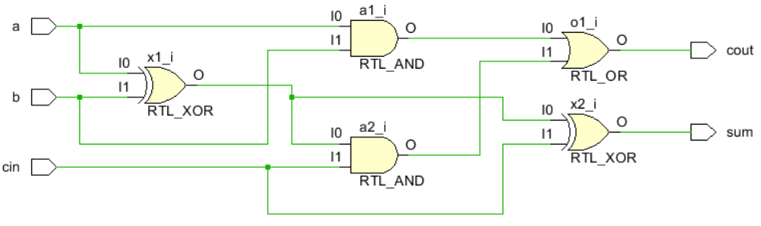
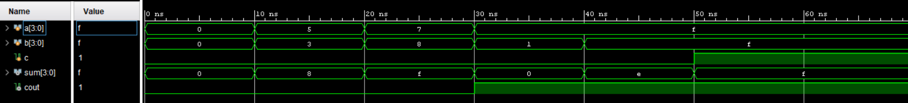
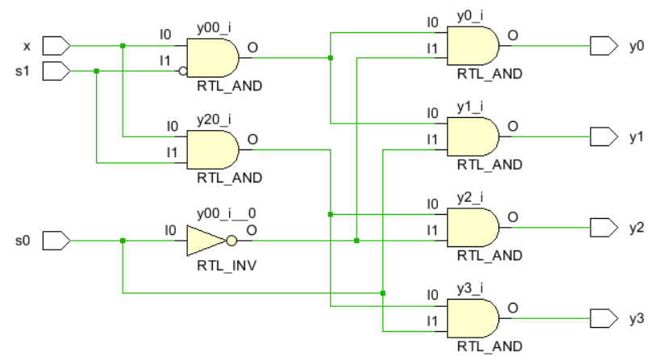
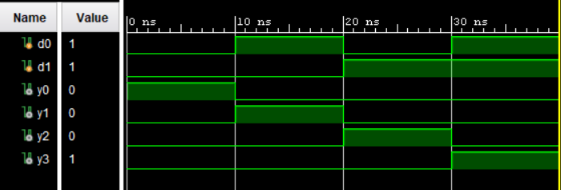
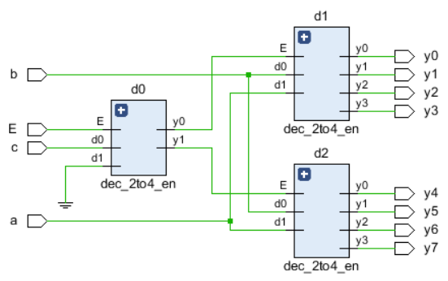
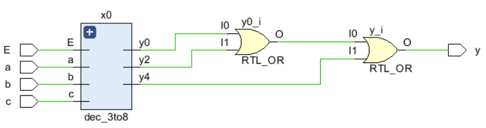
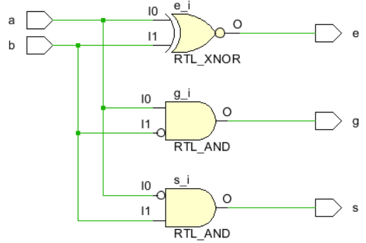

# VLSI and RTL Design Learning Log

This log records the digital-design theory studied so far and connects it to the Verilog examples in this repository. The main idea is **hardware inference**: RTL describes hardware behavior, and synthesis tools transform that description into a circuit for a target device. Different coding styles may describe the same logic; the synthesized result depends on the tool, target, and constraints.

## 1. VLSI and FPGA foundations

**VLSI** integrates large numbers of transistors on a chip. Digital design work spans frontend tasks (architecture, RTL, and functional verification) and implementation tasks (mapping, placement, routing, and timing analysis). ASICs are custom fabricated for a product; CPUs execute software on a fixed architecture; FPGAs use programmable logic and routing configured by a bitstream.

Typical FPGA resources include configurable logic blocks with lookup tables and flip-flops, programmable interconnect and I/O, and dedicated resources such as DSP slices and block RAM. The exact resources depend on the device. Vivado reports can show estimated resource use and power, but results depend on the selected part, design, constraints, and activity assumptions.

## 2. Verilog, synthesis, and verification

### RTL describes hardware

- A `wire` is a net driven by a continuous assignment, module output, or primitive. A Verilog `reg` is a procedural variable; it does **not** automatically mean a physical register. A `reg` assigned in a fully specified combinational `always` block can synthesize to combinational logic.
- `assign` describes continuous net driving. Procedural assignments (`=` and `<=`) appear in `always` or `initial` blocks.
- Blocking assignment (`=`) updates immediately within the procedural flow. Nonblocking assignment (`<=`) schedules the update for a later event region in the same time step and is the usual choice for clocked sequential logic.
- Verilog simulation uses `0`, `1`, `X` (unknown or conflicting), and `Z` (high impedance). `X` and `Z` help reveal uninitialized signals, conflicting drivers, and unconnected ports.
- Bitwise operators such as `&`, `|`, and `^` work across bits; logical operators such as `&&` and `||` produce a Boolean result. `===` and `!==` compare `X` and `Z` exactly and are useful in testbenches. Width and signedness matter in arithmetic expressions.
- Structural designs instantiate smaller modules. Named port connections are generally easier to review and less error-prone than positional connections.

### Combinational completeness

A combinational process must assign every output on every possible path. An incomplete `if` or `case` can require the output to retain its old value, causing latch inference. Use complete branches or assign defaults, and use `always @*` for Verilog combinational processes. Static `for` loops can be unrolled by synthesis when their bounds and contents are supported; testbench-only constructs such as `forever` clock loops do not describe ordinary finite combinational hardware.

### Project and testbench workflow

Vivado separates design sources from simulation sources. Select the intended top module before synthesis or simulation. Testbenches apply inputs to the DUT, then observe outputs through waveforms or console output. Delays such as `#10` and `$monitor` are simulation constructs, not ordinary synthesized hardware. Small truth tables can be exercised exhaustively; self-checking comparisons using `$error` or `$fatal` are a useful next step beyond visual inspection. Standalone waveform workflows may need VCD dumping and simulator-specific signal-access settings.

## 3. Combinational arithmetic: `01_Adders_basics/`

A **half adder** adds two one-bit inputs: `sum = a ^ b`, `carry = a & b`. A **full adder** also includes carry-in: `sum = a ^ b ^ cin` and `cout = (a & b) | (cin & (a ^ b))`. The repository explores gate-level, dataflow, behavioral, and structural versions. A structural full adder can be composed from two half adders and a carry-combining OR gate.

A **four-bit ripple-carry adder** chains four full adders. Each stage passes its carry to the next more-significant bit. This is straightforward to construct, but the carry path grows with the number of bits. The full result of adding two four-bit unsigned values and a carry-in needs five bits; `{cout, sum}` keeps the overflow bit rather than discarding it.

**Adder artifacts**

## 4. Multiplexers and routing: `02_Multiplexers/`

A **multiplexer** selects one of its data inputs. A 2-to-1 MUX implements `y = (~s & i0) | (s & i1)`. It can be written as a Boolean equation, built from gates, or described behaviorally with `if-else`. A 4-to-1 MUX uses two select bits and can be built from three 2-to-1 MUXes in two stages. MUXes can also implement Boolean functions by using variables as select inputs and deriving each data input from the truth table.

**MUX artifacts**

## 5. Demultiplexers, decoders, and encoders: `03_Decoders_Demux/`

A **1-to-4 demultiplexer** routes one input to one of four outputs according to two select bits. A **2-to-4 decoder** converts a two-bit code into a one-hot output; an active-high enable forces all outputs low when disabled. A **3-to-8 decoder** can be composed hierarchically from enabled 2-to-4 decoders. Named port mapping helps avoid wiring mistakes when some outputs are unused.

A decoder generates minterms, so a Boolean function expressed as a sum of minterms can be built by OR-ing the corresponding decoder outputs. An **encoder** performs the reverse mapping from one active input to a binary code. A **priority encoder** defines which request wins when multiple inputs are active; this is course theory, while the repository examples focus on decoding and demultiplexing.

**Decoder and demultiplexer artifacts**

## 6. Gray and binary conversion: `04_Code_Converters/`

Adjacent Gray-code values differ by one bit, which can reduce ambiguity when a changing value is observed across physical signals with unequal delays. Gray coding is useful in applications such as position sensing and asynchronous FIFO pointer techniques, but it does not replace proper clock-domain-crossing design.

For binary-to-Gray conversion, the most significant bit is unchanged and each lower Gray bit is the XOR of neighboring binary bits. For four-bit Gray-to-binary conversion:

- `B[3] = G[3]`
- `B[2] = G[3] ^ G[2]`
- `B[1] = G[3] ^ G[2] ^ G[1]`
- `B[0] = G[3] ^ G[2] ^ G[1] ^ G[0]`

The repository implements Gray-to-binary conversion both with dataflow XOR equations and with a `case` table.

## 7. Magnitude comparison: `05_Comparators/`

A one-bit comparator produces greater-than, equal, and less-than outputs:

- `g = a & ~b`
- `e = a ~^ b`
- `s = ~a & b`

For wider unsigned values, compare from the most significant bit downward: the first differing bit determines the result, while equality requires every bit pair to match. The repository implements and tests the one-bit comparator; wider comparison is covered as scaling theory. Verilog relational operators can describe wider comparisons, with care for operand widths and signedness.

## 8. Scope and next steps

The current hands-on designs cover adders, multiplexers, demultiplexing, decoders, Gray-to-binary conversion, and one-bit comparison. Topics such as ASIC physical implementation, encoder design, priority encoding, and wider comparators are included here as theory, not claimed as completed repository implementations.

Next, I plan to add self-checking testbenches, document key simulation and synthesis settings, and compare tool results without assuming a particular RTL style always maps to a particular primitive. For sequential designs, I will also document clocking, reset, and timing assumptions.
