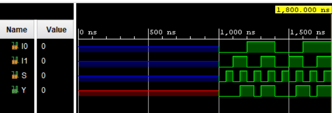
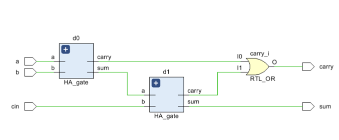

# 📖 VLSI Learning Log & Methodology

This log is an ongoing journal documenting my module-by-module progression through my VLSI coursework. It includes detailed verification setups, personal coding rules, and all visual artifacts generated from AMD/Xilinx Vivado.

---

## 🚧 Upcoming / In-Progress Modules
* Procedural Loops (`for`, `while`)
* Structural Loop implementations (`generate` blocks)

---

## Module 02: Multiplexer Architectures (`02_Multiplexers/`)

### Design Progression
* **Behavioral Modeling:** 2-to-1 Multiplexer (`MUX_2x1.v`) designed utilizing procedural `always` blocks and `if-else` conditional routing.

### Verification Methodology
Select-line verification was executed using the cascaded clock methodology. I assigned the select line (S) the highest frequency (100ns period) to visually validate the dynamic routing of the slower data channels (I0 at 400ns, I1 at 200ns) to the output net.

*(2x1 MUX RTL Schematic & Simulation Waveform)*

---

## Module 01: Combinational Arithmetic (`01_Adders_basics/`)

### Design Progression
1. **Gate-Level:** Half Adder (`HA_gate.v`) wired using explicit `xor` and `and` primitives.
2. **Dataflow:** Half Adder built using arithmetic concatenation (`half_adder_data.v`) and bitwise operators (`half_adder_data1.v`). Full Adder (`FA_data.v`) built via continuous `assign` statements.
3. **Structural:** Full Adder (`FA_using_HA.v`) constructed by instantiating sub-modules (`HA_gate.v`) and mapping the internal nets.
4. **Behavioral:** Half Adder (`HA_case.v`) implemented via procedural `case` statements to observe LUT/Multiplexer hardware inference.

### Verification Methodology: GUI Force Clocks
Instead of writing manual Verilog testbenches, I utilized Vivado's `Force Clock` continuous stimulus. By assigning cascading clock periods (400ns, 200ns, 100ns) to the input ports within the GUI, the simulator automatically cycles through all $2^n$ potential binary states.

*(Manual Force Clock Configuration & Truth Table Reference)*

*(Full Adder: Synthesized RTL Schematic & Validated Waveform)*

*(Half Adder via Case Statement: Synthesized LUT/MUX Schematic & Waveform)*

---

## 📌 Personal Coding Guidelines & Rules (Continuously Updated)
* **Assignment Rules:** Strictly use Blocking Assignments (`=`) for combinational logic and Non-Blocking Assignments (`<=`) for sequential logic inside clocked `always` blocks.
* **Procedural Constructs:** Conditional statements (`if-else`, `case`, `for` loops) cannot stand alone; they must be encapsulated within an `always` or `initial` procedural block.
* **Hardware Datatypes:** Any signal driven from within an `always` block must be declared as a `reg` data type, while continuous assignments outside procedural blocks must drive `wire` nets.