# Verilog RTL Learning Log

This log connects the circuits in this repository to the RTL concepts they demonstrate. The examples are small combinational designs: their outputs depend on the current inputs, with no clocked state.

## VLSI, FPGA, and RTL

VLSI design covers the path from defining a circuit's behavior to implementing and checking it. In this repository, the focus is on RTL and basic simulation. An FPGA implements logic using configurable resources such as lookup tables, flip-flops, programmable routing, and dedicated memory or DSP blocks. A schematic produced by a tool is one possible mapping of RTL; the exact result depends on the device, tool, and synthesis settings.

Verilog describes hardware behavior, not a sequence of software instructions:

- A `wire` is a net driven by a continuous assignment, a module output, or a primitive. A Verilog `reg` is a procedural variable; it does not by itself imply a hardware register. For example, `output reg Y` in `MUX_2x1.v` is combinational because `Y` is assigned in a complete `always @*` block.
- `assign` continuously drives a net. Procedural assignments (`=` or `<=`) are used inside `always` or `initial` blocks.
- Blocking assignment (`=`) takes effect immediately in procedural order. Nonblocking assignment (`<=`) schedules an update for the end of the current simulation time step and is the usual choice for clocked sequential logic.
- Simulation uses `0`, `1`, `X` (unknown or conflicting), and `Z` (high impedance). Unknown values can expose uninitialized inputs or incomplete stimulus. `Z` is mainly useful for modeling tri-state behavior and disconnected nets.
- Bitwise operators (`&`, `|`, `^`) operate bit by bit; logical operators (`&&`, `||`) produce a Boolean result. Case equality (`===`, `!==`) compares `X` and `Z` explicitly, which can be useful in testbenches.
- Structural RTL connects instances of smaller modules. Named port connections, used in designs such as `rca_4bit.v` and `mux_4x1.v`, make those connections easier to inspect.

### Combinational logic and checking

Every output in a combinational process must be assigned on every path. If an `if` or `case` omits an assignment, the output must retain its old value and a latch may be inferred. `MUX_2x1.v` assigns `Y` in both branches; `gtob_case.v` includes a `default`, so `b` is assigned for every possible input value.

The `tb_*.v` files apply input patterns and use `$monitor` to print signal changes. A printed truth table is useful for visual inspection, but it does not automatically check correctness. A self-checking testbench compares each result with an expected value and reports a failure when they differ.

The project READMEs describe a Vivado workflow: add the design and its testbench as simulation sources, set the testbench as the simulation top, and run behavioral simulation. The repository does not currently provide a shared command-line test runner or build manifest.

## 1. Adders — `01_Adders_basics/`

A half adder adds two one-bit inputs: `sum = a ^ b` and `carry = a & b`. A full adder adds a third input, `cin`; the sum is the XOR of all three inputs, and the carry is high when at least two inputs are high. The full-adder examples show the same function in dataflow, gate-level, behavioral, and structural forms. In `FA_using_HA.v`, two half adders produce partial sums and carries, which are combined to form the full-adder outputs.

`rca_4bit.v` chains four full adders. Each bit's carry-out feeds the next bit's carry-in, from the least significant bit toward the most significant bit. This simple structure makes the dependency clear, but the carry must pass through each stage, so the carry path gets longer as the adder grows.

### Figures

The first four figures document the full-adder setup and its behavior: the force-clock view shows how inputs were driven in Vivado, the truth table lists all eight input combinations, and the schematic and waveform show the synthesized logic and simulated outputs.

The half-adder `case` pair and the full-adder `case`, gate, and `if` pairs compare different RTL descriptions of the same small combinational functions. For each pair, the schematic is the tool's logic view; the simulation image is evidence of the input/output behavior. These are alternative implementations, not separate circuit features.

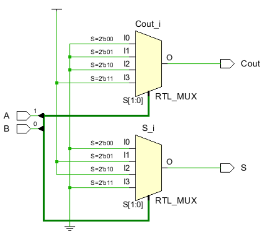

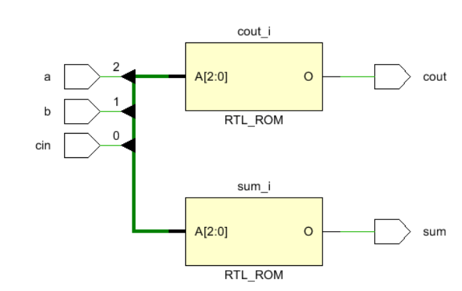

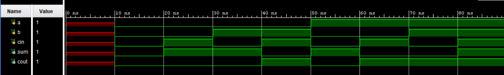

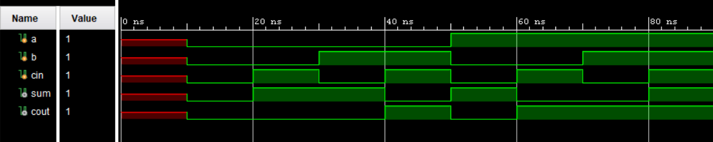

The final pair shows the four-stage ripple connection and selected arithmetic cases. In particular, inputs such as 15 + 1 and 15 + 15 demonstrate why the 4-bit `sum` alone is not the full result: `cout` carries the overflow beyond bit 3.

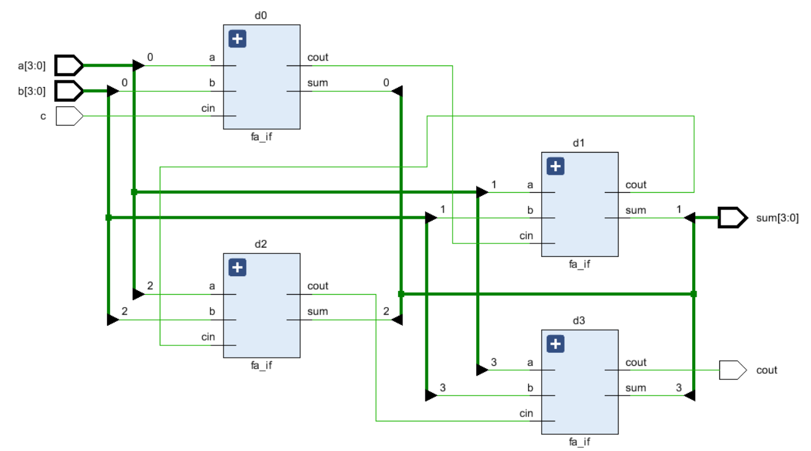

## 2. Multiplexers — `02_Multiplexers/`

A 2-to-1 multiplexer routes one of two inputs to its output: `y = (~s & i0) | (s & i1)`. When `s` is 0, the output follows `i0`; when `s` is 1, it follows `i1`. `MUX_2x1.v`, `MUX_2x1_gate.v`, and `MUX2x1_data.v` describe this behavior procedurally, with gates, and with a Boolean expression.

`mux_4x1.v` builds a 4-to-1 MUX from three 2-to-1 instances. `s0` selects within each input pair, and `s1` selects between the two intermediate results. The testbench uses distinct input values so that changing the select bits makes the selected path visible in the output.

### Figures

The first two images show the behavioral 2-to-1 MUX: its schematic and the simulation response as the select input changes.

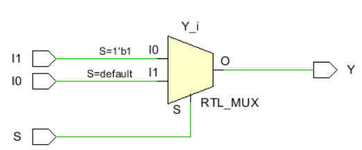

These images show the gate-level version. The gate schematic makes the inverter, AND, and OR implementation of the selection equation visible; the waveform checks its output against the selected data input.

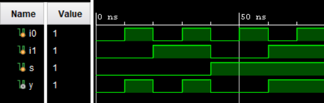

The dataflow version expresses the same selection equation with a continuous assignment. Its schematic and simulation are a comparison with the behavioral and gate-level descriptions, not a different MUX function.

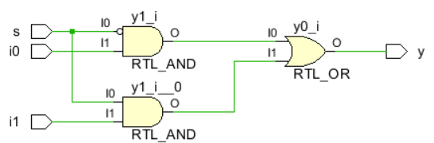

The 4-to-1 MUX figures show the three-instance hierarchy and the output as all four select codes are applied.

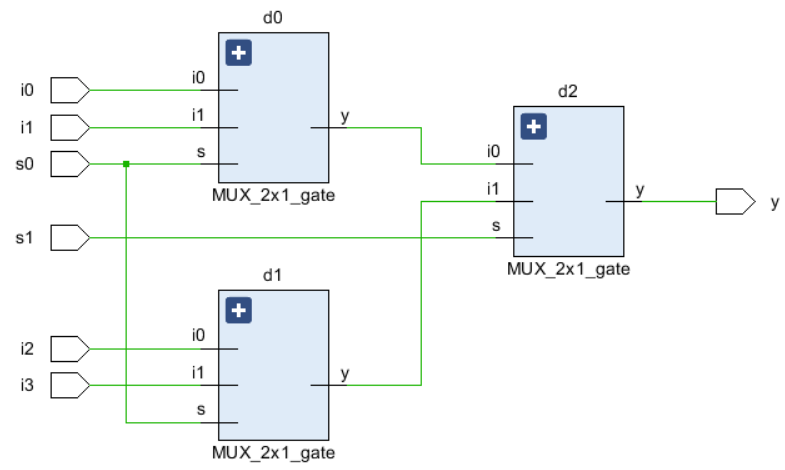

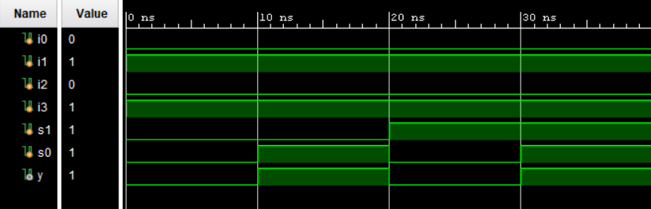

## 3. Demultiplexers and decoders — `03_Decoders_Demux/`

A 1-to-4 demultiplexer routes one data input to one of four outputs, according to its two select bits. A 2-to-4 decoder does a related but different job: it activates one output corresponding to a two-bit input code. In `dec_2to4_en.v`, the enable `E` gates all four minterms; when it is low, every output is low.

`dec_3to8.v` composes enabled 2-to-4 decoders to produce eight one-hot outputs. `func_decoder.v` then demonstrates a common use for a decoder: OR selected minterm outputs to implement a Boolean function (`d0 | d2 | d4`).

### Figures

The demultiplexer schematic shows the data-routing logic. Its simulation exercises the select combinations and shows which output receives the input value.

The 2-to-4 decoder pair shows the one-hot output behavior for the two-bit input code. The separate 3-to-8 pair shows how the smaller enabled decoders are connected to expand the number of decoded outputs.

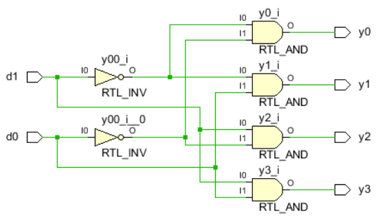

The final pair documents the decoder-based function. The schematic shows the selected decoder outputs combined at `y`; the simulation applies input codes so the output can be compared with the chosen minterms.

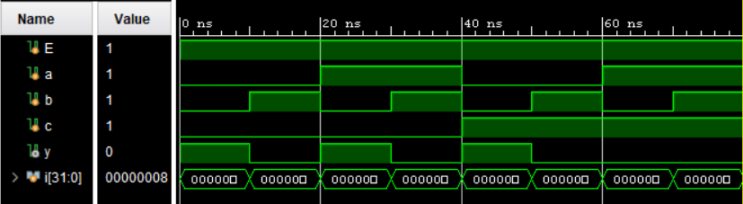

## 4. Gray-to-binary conversion — `04_Code_Converters/`

In a reflected Gray-code sequence, adjacent values differ in one bit. This property can reduce the chance of observing a multi-bit transition partway through when a changing value crosses physical signals with unequal delays; it does not remove the need for appropriate clock-domain-crossing design.

For four-bit Gray-to-binary conversion, the most significant binary bit is the Gray MSB, and each following binary bit is the XOR of the preceding binary bit and the next Gray bit:

- `B[3] = G[3]`
- `B[2] = B[3] ^ G[2]`
- `B[1] = B[2] ^ G[1]`
- `B[0] = B[1] ^ G[0]`

`gtob_data.v` expresses these equations directly. `gtob_case.v` lists all 16 input/output mappings. Its `default` assignment makes the combinational block complete; it is not a special mechanism needed only for invalid Gray codes.

The schematic shows the XOR logic inferred from the dataflow equations. The waveform corresponds to the testbench sweep over all 16 four-bit input patterns; the current testbench instantiates `gtob_case` and can be switched to `gtob_data` for comparison.

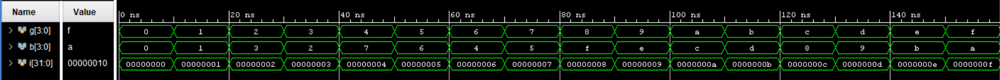

## 5. One-bit magnitude comparator — `05_Comparators/`

The one-bit comparator produces three mutually exclusive results:

- `g = a & ~b`: `a` is greater than `b`.
- `e = a ~^ b`: the inputs are equal (XNOR).
- `s = ~a & b`: `a` is smaller than `b`.

The schematic shows the logic for all three outputs. The simulation applies the four possible input pairs and lets the three comparison results be checked together. For wider unsigned values, comparison proceeds from the most significant bit: the first differing bit determines the result, while equality requires every bit pair to match.

## Scope and next work

The examples cover combinational arithmetic, selection and routing, decoding, Gray-to-binary conversion, and one-bit comparison. They do not yet cover sequential blocks, finite-state machines, an encoder, parameterized designs, or ASIC physical implementation. A useful next improvement is to make the existing testbenches self-checking, so correctness is reported as `PASS` or `FAIL` rather than left to waveform inspection or `$monitor` output.
