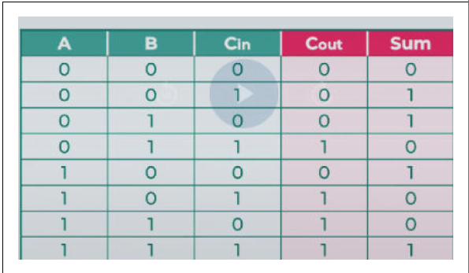

# VLSI Learning Log & Lab Notes

This is my personal engineering notebook for the Internshala VLSI course. I use this file to jot down theoretical concepts, synthesis behaviors I notice in Vivado, and verification results as I build out the modules. 

The main goal right now is getting completely comfortable with Gate-Level, Dataflow, Structural, and Behavioral RTL modeling before tackling the larger projects.

---

## Toolchain & Methodology Notes

### Vivado: Resource and Power Estimation
* **Synthesis & Utilization:** After running synthesis, checking the "Project Summary" reveals the Resource Utilization percentages (like LUTs and I/O ports). If a design outgrows the current board, you can click the device name to swap to a larger FPGA (e.g., an Artix-7) and resynthesize.
* **Power Estimation:** Clicking "Report Power" under the Implementation tab allows for adjusting environmental variables (like ambient temperature) to generate a detailed report splitting on-chip power into static and dynamic consumption.

### Verification & AI Workflow Integration
* **Prompting for RTL:** When prompting for Verilog design code, provide a structured request that explicitly defines the module name, number of inputs and outputs, bit-widths, modeling style (such as dataflow or continuous assignment), and whether the code must be synthesizable.
* **Testbench Generation:** I generate base testbenches by pasting the Verilog module into the chat and commanding the AI to write a testbench that covers all possible input combinations and uses the `$monitor` command to print the results. After generating, I copy the final, refined testbench back into the Vivado environment to run the simulation.
* **Edge-Case Handling:** If exhaustive testing is impossible due to massive input combinations (like multiple 8-bit inputs), I adopt the AI's practical recommendation to use randomized testing with loops.

---

## Module 2 (Part B): Hardware Data Types & Syntax

### Nets vs. Procedural Variables
* **`wire`:** Think of this as an actual physical copper wire. It can't store memory. It has to be continuously driven by something (like an `assign` statement or the output of another module).
* **`reg`:** This is a procedural variable used inside `always` or `initial` blocks. The tricky part? Just because it's called `reg` doesn't mean it always becomes a hardware register (flip-flop). Depending on how you write the code, Vivado might turn it into a flip-flop, a latch, or just plain combinational logic.

### Loops in Hardware
* **Synthesizable (`for`):** You can use `for` loops in RTL, but only if the start and end points are fixed numbers. The synthesizer essentially "unrolls" the loop and copy-pastes the hardware gates side-by-side. 
* **Not Synthesizable (`while`, `forever`):** Dynamic loops usually can't be synthesized into physical hardware because the compiler doesn't know how many gates to build. I only use `forever` loops inside testbenches to generate clock signals.

### Operators
* **Concatenation `{}`:** Super useful for bundling individual signals into a bus. Example: `assign {cout, sum} = a + b;`
* **Bitwise vs. Logical:** `&` and `|` map directly to physical AND/OR gates for every bit in a wire. `&&` and `||` just return a simple True/False (1/0), mostly used for `if` conditions.

---

## Module 2 (Part A): Multiplexers (`02_Multiplexers/`)

**What I built:** 2-to-1 Multiplexers using three different abstractions:
* **Gate-Level:** Wired raw `not`, `and`, and `or` primitives (`MUX_2x1_gate.v`).
* **Dataflow:** Used boolean logic equations inside an `always @*` block (`MUX2x1_data.v`).
* **Behavioral:** Used an `always @*` block with procedural `if-else` routing (`MUX_2x1.v`).

**Notes on Synthesis:** 
Using an `if-else` block inside combinational logic works perfectly. Vivado recognizes the pattern and infers a dedicated hardware multiplexer rather than trying to build it out of generic logic gates.

**Verification:** 
I wrote exhaustive automated testbenches for each abstraction (`tb_MUX_2x1.v`, `tb_mux_2x1_gate.v`, `tb_mux2x1_data.v`). Using `$monitor` let me print the truth table directly to the console every time the inputs changed.

### Visual Artifacts

*(2x1 MUX Behavioral: Synthesized Schematic & Waveform)*

*(2x1 MUX Gate-Level: Synthesized Schematic & Waveform)*

*(2x1 MUX Dataflow: Synthesized Schematic & Waveform)*

---

## Modules 1 & 3: Combinational Arithmetic (`01_Adders_basics/`)

**What I built:** Half Adders, Full Adders, and a 4-bit Ripple Carry Adder across different abstraction levels.
* **Gate-Level:** Wired up raw `xor`, `and`, and `or` primitives (`HA_gate.v`, `fa_gate.v`).
* **Dataflow:** Used arithmetic concatenation and continuous `assign` statements (`FA_data.v`).
* **Structural:** Built a Full Adder by instantiating two Half Adders (`FA_using_HA.v`), and built a 4-bit RCA by cascading four Full Adders using named port mapping (`rca_4bit.v`).
* **Behavioral:** Built adders by giving the compiler the truth table via `case` and `if-else` statements (`HA_case.v`, `fa_case.v`, `fa_if.v`). 

**Notes on Synthesis:**
* **Abstraction doesn't change the waveform:** Whether I manually wired the gates or just wrote a behavioral `case` statement, the simulation waveforms looked exactly the same. The difference is only visible in the RTL Schematics.
* **The missing `default` danger:** When writing `fa_case.v`, I realized that if a `case` statement fails to assign an output for every possible condition, Vivado infers memory latches to hold the previous state. Adding a `default` fallback (or explicitly defining every single combination) prevents this and keeps the circuit strictly combinational.

**Verification:**
I have completely transitioned from manual GUI Force Clocks to automated testbenches. My simulation files (like `tb_fa_case.v`) use `#10` nanosecond delays to step through inputs, generating exhaustive, repeatable truth tables in the console. For larger designs like the 4-bit RCA (`tb_rca_4bit.v`), I used targeted edge-case stimulus (e.g., testing `15 + 15 + 1 = 31`) to verify carry rippling.

### Visual Artifacts

*(Manual Force Clock Configuration & Truth Table Reference)*

*(Full Adder: Synthesized RTL Schematic & Validated Waveform)*

*(Half Adder via Case Statement: Synthesized LUT/MUX Schematic & Waveform)*

*(Full Adder via Case Statement: Synthesized Schematic & Waveform)*

*(Full Adder via Gate Primitives: Synthesized Schematic & Waveform)*

*(Full Adder via If-Else Routing: Synthesized Schematic & Waveform)*

*(4-bit Ripple Carry Adder: Structural Schematic & Waveform)*

