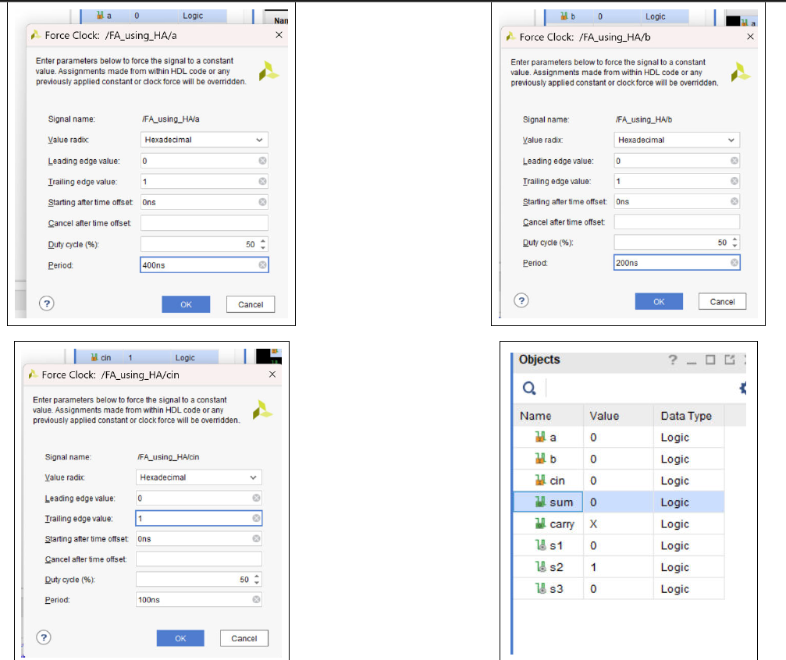
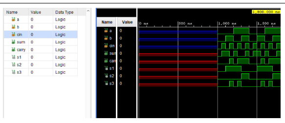
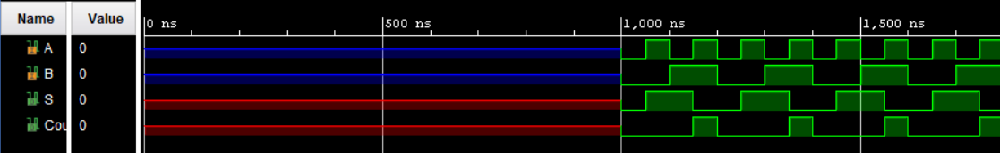

# VLSI Learning Log & Engineering Methodology

**Purpose:** This document serves as a technical engineering methodology log tracking my progression through the Internshala VLSI coursework. It captures design implementations, synthesis insights, verification strategies, and core RTL coding principles.

**Course Objective:** To transition from theoretical digital logic to practical, synthesizable hardware design using Verilog HDL and AMD/Xilinx Vivado.

**Learning Outcomes:** 
* Mastery of Gate-Level, Dataflow, Structural, and Behavioral RTL modeling.
* Understanding the physical synthesis impact of procedural constructs and assignments.
* Testbench-free waveform verification using continuous GUI stimulus.

*(Note: Comprehensive practical assignments, such as the 8-bit ALU and FSM Pattern Detectors, are batched for execution upon completion of core theoretical modules.)*

---

## Module 02 (Part B): Core HDL Concepts & Data Types

### Theory: Hardware Data Types
* **`wire` (Nets):** A net type used for physical connections and combinational outputs. It must be driven continuously (e.g., via `assign` or module instantiation) and does not inherently store values.
* **`reg` (Procedural Variables):** A procedural variable driven from within a procedural block (`initial` or `always`). Depending on the context and coding style, a `reg` may synthesize to a physical flip-flop, a latch, or purely combinational logic.

### Theory: Procedural Loops in Synthesis
* **Synthesizable Loops (`for`):** Can be synthesized into hardware provided the loop bounds are static, allowing the synthesizer to unroll the loop and generate parallel physical gates.
* **Non-Synthesizable Loops (`while`, `forever`):** Dynamic `while` loops are generally not synthesizable for RTL because the loop iteration count is not static. `forever` loops are restricted entirely to testbench stimulus generation.

### Theory: Verilog Operators
* **Concatenation `{}`:** Combines scalar or vector nets into a wider bus (e.g., `assign {cout, sum} = a + b;`).
* **Bitwise vs. Logical:** Bitwise operators (`&`, `|`, `^`) map directly to parallel hardware gates for each bit in a bus. Logical operators (`&&`, `||`, `!`) evaluate to a single scalar boolean (1/0) for conditional routing.

---

## Module 02 (Part A): Multiplexer Architectures (`02_Multiplexers/`)

### Concept & Design Approach
* **Implementation:** 2-to-1 Multiplexer (`MUX_2x1.v`).
* **Design Style:** Behavioral Modeling. Utilized procedural `always @*` blocks and `if-else` conditional routing.

### Synthesis Insight
The use of `if-else` inside a combinational `always` block successfully instructs the Vivado synthesizer to infer a dedicated hardware multiplexer rather than generic logic gates.

### Verification Method
Select-line verification was executed using cascaded clocks. The select line (S) was assigned a 100ns period to validate the dynamic routing of the slower data channels (I0 at 400ns, I1 at 200ns) to the output net.

*(2x1 MUX RTL Schematic & Simulation Waveform)*

---

## Module 01: Combinational Arithmetic (`01_Adders_basics/`)

### Concept & Design Approach
* **Gate-Level:** Half Adder (`HA_gate.v`) wired using explicit `xor` and `and` primitives.
* **Dataflow:** Half Adder built using arithmetic concatenation (`half_adder_data.v`) and bitwise operators (`half_adder_data1.v`). Full Adder (`FA_data.v`) built via continuous `assign` statements.
* **Structural:** Full Adder (`FA_using_HA.v`) constructed by instantiating sub-modules (`HA_gate.v`) and hierarchically mapping internal nets.
* **Behavioral:** Half Adder (`HA_case.v`) implemented via procedural `case` statements.

### Synthesis Insight
* Behavioral modeling using `case` statements allows the synthesizer to efficiently infer LUTs (Look-Up Tables) from truth table definitions.
* Omitting a `default` fallback in a combinational `case` block causes the synthesizer to inject unintentional memory latches, violating strict combinational timing closures.

### Verification Method
Verification was performed via automated truth table validation utilizing Vivado's `Force Clock` GUI methodology. By assigning cascading clock periods (400ns, 200ns, 100ns) to input ports, the simulator cycled through all binary states.

*(Manual Force Clock Configuration & Truth Table Reference)*

*(Full Adder: Synthesized RTL Schematic & Validated Waveform)*

*(Half Adder via Case Statement: Synthesized LUT/MUX Schematic & Waveform)*

