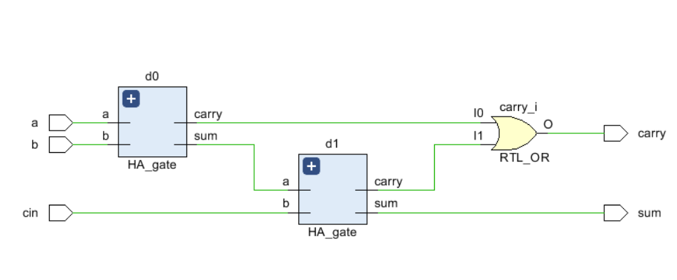
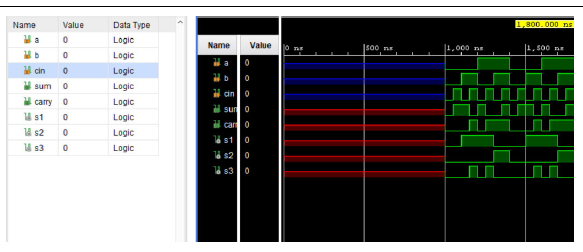
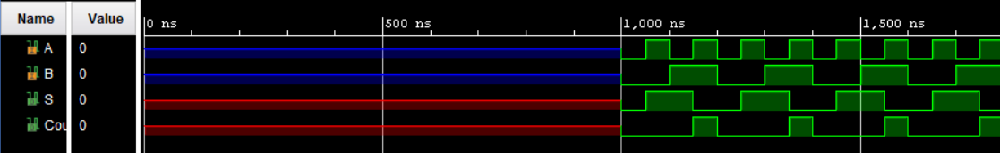
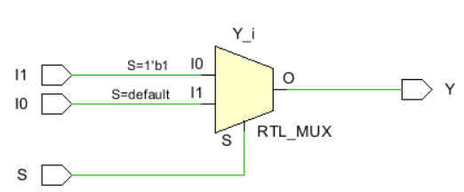
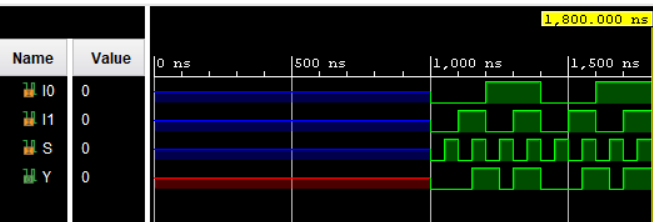

# Verilog RTL Foundations

A repository containing Verilog HDL implementations of foundational digital circuits, synthesized and verified using AMD/Xilinx Vivado. Designs demonstrate standard RTL modeling paradigms including Gate-Level, Dataflow, Structural, and Behavioral modeling.

---

## 01: Combinational Arithmetic (`01_Adders_basics/`)

### Design Implementations
* **Gate-Level Modeling:** Half Adder (`HA_gate.v`) implementation using explicit `xor` and `and` primitives.
* **Dataflow Modeling:** Half Adder implementations using arithmetic concatenation (`half_adder_data.v`) and bitwise operators (`half_adder_data1.v`). Full Adder (`FA_data.v`) constructed via continuous assignments (`assign`).
* **Structural Modeling:** Full Adder (`FA_using_HA.v`) constructed by instantiating sub-modules (`HA_gate.v`) and mapping internal nets.
* **Behavioral Modeling:** Half Adder (`HA_case.v`) implemented via procedural `case` statements, demonstrating Vivado's LUT/Multiplexer inference from truth table definitions.

### Verification & Automated Simulation
**Toolchain:** AMD / Xilinx Vivado (IEEE 1364 Verilog HDL)

**Methodology:** Combinational logic verification was performed without traditional testbenches by utilizing Vivado's `Force Clock` continuous stimulus. By assigning cascading clock periods (400ns, 200ns, 100ns) to input ports, the simulator automatically cycles through all potential binary states to validate the combinatorial truth tables.

**Synthesis & Verification Artifacts:**

*(RTL Synthesis Schematic)*

*(Full Adder Waveform)*

*(Behavioral Half Adder Waveform)*

---

## 02: Multiplexer Architectures (`02_Multiplexers/`)

### Design Implementations
* **Behavioral Modeling:** 2-to-1 Multiplexer (`MUX_2x1.v`) designed utilizing procedural `always` blocks and `if-else` conditional routing.

### Verification
Select-line verification was executed using the cascaded clock methodology. The select line (S) was assigned the highest frequency (100ns period) to visually validate the dynamic routing of the slower data channels (I0 at 400ns, I1 at 200ns) to the output net.

**Synthesis & Verification Artifacts:**

*(2x1 MUX RTL Schematic)*

*(2x1 MUX Simulation Waveform)*

---

## RTL Coding Guidelines

* **Assignment Rules:** Use Blocking Assignments (`=`) for combinational logic. Use Non-Blocking Assignments (`<=`) for sequential logic inside clocked `always` blocks.
* **Procedural Constructs:** Conditional statements (`if-else`, `case`) must be encapsulated within an `always` or `initial` procedural block.
* **Data Types in Procedural Blocks:** Any signal driven from within an `always` block must be declared as a `reg` data type. Continuous assignments outside procedural blocks must drive `wire` data types.
* **Combinational Latch Prevention:** When inferring combinational logic using `case` or `if-else` statements, all possible input conditions must be explicitly defined, or a `default`/`else` fallback must be provided. Failure to cover all states results in the synthesis of unintentional latches, violating combinational timing closures.